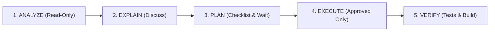

# VentaPOS NextGen — Developer System Rules & Architecture Bible

This document is the supreme Single Source of Truth (SSoT) governing the architecture, runtime environment, business rules, and developer workflows for VentaPOS NextGen. All AI agents and human developers must strictly adhere to these rules without hallucination or deviation.

---

## 0. Application Overview

VentaPOS NextGen is **NOT** a point-of-sale terminal. It is a **back-office desk management application** for a single business owner / manager (المدير / صاحب المحل) who sells furniture, household appliances, and electronics (مفروشات، أدوات منزلية، أجهزة كهربائية).

**Core Workflow:** Salespeople (مناديب) sell products in the field using physical paper notebooks $\rightarrow$ the manager enters those receipts into this desktop application from his office desk.

### Fundamental Operating Realities
- **Single User**: One manager, one admin account (`admin`), no other roles or user tiers.
- **Single Machine**: Offline-first desktop application running on a local SQLite database in WAL mode.
- **Multi-Branch Isolation**: The manager manages multiple branches/warehouses from a single interface. Each branch maintains completely independent inventory. There are **zero** transfers between branches.
- **No Barcode / SKU**: Products are identified purely by Arabic text name via searchable autocomplete.
- **No Fixed Selling Price on Product**: There is no `selling_price` column on products. The manager enters the sale price per unit directly onto each receipt.
- **Selective Printing**: Physical printing is strictly reserved for **Installment Schedules**. Standard cash receipts are not printed.

---

## 1. Single Source of Truth (SSoT) Protocol

The codebase contains legacy directories (`Desktop/`, `Server/`, etc.) from previous prototypes. You are **strictly forbidden** from referencing them.

Before analyzing or writing ANY code, you MUST use `view_file` to read ONLY these valid SSoT files:

1. **`GEMINI.md` / `.agents/AGENTS.md`**: Architecture, desktop runtime rules, red lines, and developer protocols.
2. **`.agents/CODEBASE_MAP.md`**: Compressed interface map (~10KB) covering backend models, viewsets, and frontend structures.
3. **`VentaPOS_NextGen/requirements.md`**: Confirmed 17 data models, business rules, stock formulas, and active API catalog.
4. **`VentaPOS_NextGen/UI_UX_RULES.md`**: Visual identity, design tokens, native sticky table guidelines, and verified Arabic report specifications.
5. **`VentaPOS_NextGen/TODO.md`**: Master task and bug tracker containing **Priority 0: Critical Backend Bug Fixes** and roadmap items.

*Violation of this protocol (inventing schemas or using old documents) is considered a critical failure.*

---

## 2. Desktop Runtime Environment (Waitress + pywebview + PyInstaller)

The application packages a Django REST Framework backend and a built React frontend into a standalone Windows executable.

### 2.1 Process Execution Architecture
- **Launcher Entry Point**: `VentaPOS_NextGen/launcher.py`.
- **Embedded Web Server**: Waitress serves Django's WSGI application on `127.0.0.1` using a dynamically allocated free port (`socket.bind(('127.0.0.1', 0))`).
- **Native GUI Window**: `pywebview` creates a native desktop window pointing to `http://127.0.0.1:{port}`.
- **Headless Stream Handling**: In PyInstaller `--windowed` mode, `sys.stdout` and `sys.stderr` are `None`. A `DummyWriter` class must stub `write()` and `flush()` to prevent fatal `AttributeError` crashes on `print()` or logging statements.

### 2.2 Filesystem & Path Resolution (`sys.frozen` Awareness)
- **Bundled Read-Only Assets**: When running inside PyInstaller, `sys.frozen` is `True` and static assets/templates are located at `sys._MEIPASS`.
- **Writable Data Directory (`DB_DIR`)**: The SQLite database (`db.sqlite3`) and runtime backups must NEVER be written to `sys._MEIPASS` (which is read-only and deleted on exit). Database paths must resolve to a persistent, writable application directory:
  ```python
  if getattr(sys, 'frozen', False):
      BASE_DIR = Path(sys._MEIPASS)
      DATA_DIR = Path(os.environ.get('APPDATA', Path.home())) / 'VentaPOS'
  else:
      BASE_DIR = Path(__file__).resolve().parent.parent
      DATA_DIR = BASE_DIR
  DATA_DIR.mkdir(parents=True, exist_ok=True)
  DATABASES = {
      'default': {
          'ENGINE': 'django.db.backends.sqlite3',
          'NAME': DATA_DIR / 'db.sqlite3',
      }
  }
  ```
- **Static Assets**: React's production build (`frontend/dist/`) is served directly by Django via `whitenoise.middleware.WhiteNoiseMiddleware`.

---

## 3. Forbidden Actions (الخطوط الحمراء)

You are strictly forbidden from implementing or proposing the following:

1. **NO Multi-Tenancy & NO Cloud**: The application is strictly an offline-first single-tenant desktop app. Never generate `Tenant` models, cloud sync protocols, or multi-tenant database routers.
2. **NO Hard Deletes**: Never call `obj.delete()`. All models use soft deletes via `is_deleted = True` and an `ActiveManager`.
3. **NO UUID Primary Keys**: Do not use `UUIDField` for database PKs. Use Django's default auto-incrementing integer `AutoField` or `BigAutoField`.
4. **NO Direct Python Execution**: Never run `.py` files directly in Windows terminal (e.g. `.\script.py`). Always prepend the Python executable (e.g. `python script.py`).
5. **NO Unstyled Tables**: Raw HTML tables are banned. All tables must implement the Native Window Sticky Scroll architecture.
6. **NO Customer Model**: Customers are implicit text fields on receipts (`customer_name`, `phone_number`, `address`, `area`) with historical autocomplete. Never create a `Customer` model or account balances.
7. **NO Selling Price on Product**: `InventoryItem` does NOT have a `selling_price` field. The manager enters the price per sale on each receipt.
8. **NO Smart Import**: Excel import has been permanently removed from scope.
9. **NO Action Logs**: The `ActionLog` model has been permanently removed. Do not recreate it.
10. **NO Expense Categories**: Expenses have free-text descriptions only. Never add category foreign keys or enums.

---

## 4. Core Business Rules (القواعد التجارية)

### 4.1 Payment Types
- Restricted to **Cash (نقدي)** and **Installments (تقسيط)** only.
- No card/visa payments. No deferred credit (آجل). No split payments across multiple payment methods.

### 4.2 Installment Scheduling
- **Schedule Generation Only**: The system calculates the monthly installment dates and amounts. It does **not** track actual ongoing payment collections or individual installment statuses.
- **The 25th Convention**: The day "25" is printed on schedules for aesthetic consistency in the trade; it has zero significance in calculations.
- **Monthly Arithmetic**: What matters is the installment `month` and `year` (e.g. 3,000 EGP over 6 months = 500 EGP/month starting the month following the sale).

### 4.3 Commission Architecture
- **Sales Commission (مندبة)**: Fixed monetary value per unit sold per product (e.g. 50 EGP/unit). Stored in `CommissionHistory` per product to track rate changes across business months.
- **Collection Commission (عمولة تحصيل)**: Company-wide percentage stored in `CompanySetting.collection_commission_rate` (default `0.10` / 10%).
- **Salesperson Monthly Salary**:
  $$\text{Salary} = \sum(\text{مندبة} \times \text{units sold}) + (\text{collection\_rate} \times \text{monthly collections})$$
  Salespeople are 100% commission-based; there is no base salary.

### 4.4 Date System & Digits Convention
- **Monthly-Based Accounting**: Storage and filtering operate on integer `month` and `year` fields, not daily timestamps. `DefaultDate` returns the active business month.
- **Display Format**: `YYYY/MM` (e.g. `2026/08` — 4-digit year, slash, 2-digit month with leading zero).
- **Date Inputs**: In forms and filter toolbars, dates must be entered using **two separate numeric inputs** (`month` and `year`), never browser-native `<input type="date">` or `<input type="month">`.
- **Digits Convention**: Western ASCII digits (`0-9`) are used universally for display, inputs, and APIs. Arabic-Indic digits (٠١٢٣٤٥٦٧٨٩) are banned to prevent parsing failures and split-brain state bugs.

### 4.5 Inventory Stock Calculation (Time-Machine Method)
- Stock is calculated dynamically across time:
  $$\text{Stock} = \max(0, \text{initial\_qty} + \text{purchases} + \text{surplus} + \text{sales\_returns} - \text{sales} - \text{purchase\_returns} - \text{deficit})$$
- `Receipt` records with `receipt_type='RETURN'` restore inventory, while `receipt_type='SALE'` deduct inventory.
- Stock is clamped to `max(0, ...)` — physical inventory can never be negative.

---

## 5. Application Lifecycle (Demo → License → Setup)

1. **First Launch (No License)**: App launches in **Demo Mode** with realistic sample data.
2. **Subsequent Launches in Demo**: Database is wiped and fresh demo data is re-generated on every restart.
3. **License Activation**: When a valid 80-bit license is entered:
   - All demo data is completely wiped.
   - The database is emptied.
   - The user is redirected to the **Setup Wizard** (`/activation-setup`).
4. **Production Operation**: After initial branch and password configuration, the app operates with persistent real data.

---

## 6. UI, UX, & Language Principles

### 6.1 Language & Market Terminology
- **Strictly RTL & Arabic**: The entire UI is Right-to-Left Arabic.
- **Tone**: Professional Egyptian commercial Arabic (لغة سوق مهنية ومبسطة).
- **Business Terms**: العميل, البضاعة, الخزنة, الفاتورة, الدفتر, النقدية, المندبة, المرتجع.

### 6.2 Visual Identity
- **Primary Brand Color**: Deep Blue (`#123F68`).
- **Accent / Success Color**: Emerald Green (`#1DA368`) — used for confirm, save, pay, and primary totals.
- **Typography**: 'Cairo' font across all elements.
- **Framework**: Tabler / Bootstrap v5 utilities + custom CSS. No Tailwind.

### 6.3 Data Density & Keyboard-First UX
- **Fluid Layout**: Use `container-fluid` across all views.
- **Compact Density**: Small padding and compact fonts in tables to maximize rows visible without vertical scrolling.
- **Keyboard Navigation**: Autofocus on initial fields, Enter moves to next logical input, logical Tab-indexing throughout.

---

## 7. Mandatory 5-Phase Workflow

Every feature, refactor, or bug fix must follow this exact sequence:



1. **Phase 1: ANALYZE (Read-Only)**: Read all involved files via `view_file`. No code changes.
2. **Phase 2: EXPLAIN (Talk First)**: Explain current logic, required modifications, and risks.
3. **Phase 3: PLAN (Propose & Wait)**: Deliver a detailed atomic checklist and wait for explicit user approval.
4. **Phase 4: EXECUTE**: Apply only approved edits.
5. **Phase 5: VERIFY**:
   - Backend tests: `cd VentaPOS_NextGen\backend && D:\Projects\VentaPOS\VentaPOS_NextGen\venv\Scripts\python.exe manage.py test api.tests -v 2`
   - Frontend build: `cd VentaPOS_NextGen\frontend && npm run build`
   - **Never modify existing tests to force them to pass.**

---

## 8. Developer Protocols & Anti-Patterns

### 8.1 Educator Mode & Challenger Mode
- Always explain the *why* behind architectural choices.
- If a requested action violates the Red Lines, breaks SSoT rules, or degrades maintainability, you must push back respectfully and explain the risk.

### 8.2 Machine Signatures (Anti-Patterns to Avoid)
1. **Modular Mirage**: Moving code to another file without high semantic cohesion is not refactoring.
2. **Test Mutation**: Modifying tests to match broken implementation is strictly forbidden.
3. **Terminal Tool Abuse**: Never use `cat`, `ls`, or `grep` terminal commands to inspect files. Use native Antigravity read tools (`view_file`, `run_command` with PowerShell).
4. **Context Degradation**: Always maintain the Context Checkpoint protocol after completing tasks.
