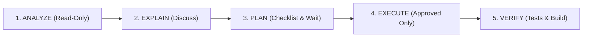

# VentaPOS NextGen — Master Rules & Engineering Governance

This document is the active `always_on` governance rulebook for the VentaPOS monorepo (`VentaPOS_NextGen` and `LicenseManager`). All AI agents, subagents, and human developers must strictly adhere to these rules without hallucination or deviation.

For complete architectural details, model fields, API contracts, React components, and PyInstaller build specs, always read and keep synchronized with root **`APP_BIBLE.md`**.

---

## 0. Application Overview

VentaPOS NextGen is **NOT** a point-of-sale terminal. It is a **back-office desk management application** for a single business owner / manager (المدير / صاحب المحل) who sells furniture, household appliances, and electronics (مفروشات، أدوات منزلية، أجهزة كهربائية).

**Core Workflow:** Salespeople (مناديب) sell products in the field using physical paper notebooks $\rightarrow$ the manager enters those receipts into this desktop application from his office desk.

### Fundamental Operating Realities
- **Single User**: One manager, one admin account (`admin`), no other roles or user tiers.
- **Single Machine**: Offline-first desktop application running on a local SQLite database in WAL mode.
- **Multi-Branch Isolation**: The manager manages multiple branches/warehouses from a single interface. Each branch maintains completely independent inventory. There are **zero** transfers between branches.
- **No Barcode / SKU**: Products are identified purely by Arabic text name via searchable autocomplete.
- **No Fixed Selling Price on Product**: There is no `selling_price` column on products. The manager enters the sale price per unit directly onto each receipt.
- **Selective Desktop Printing**: Retail cash sales receipts do not have thermal POS printouts, and data entry screens (`POS.jsx` and `PurchaseEntry.jsx`) have **strictly NO printing**. Desktop printing (`PrintModal.jsx`) is supported exclusively inside search and report screens (`SearchReceipts.jsx`, `SearchPurchases.jsx`, `InstallmentsReport.jsx`, and `ReportsLayout.jsx` / `ReportTable.jsx`) for: (1) **Installment Schedules** (جداول إيصالات الأقساط), (2) **Purchase & Supplier Return Invoices** (`pdf_purchase_content.html`), and (3) **Analytical & Administrative Reports** (`pdf_report_content.html`).

---

## 1. Single Source of Truth (SSoT) Protocol

The workspace contains legacy/archived directories (`Desktop/`, `Server/`, `_archive/`, etc.) from previous prototypes. You are **strictly forbidden** from referencing them.

Before analyzing, planning, or writing ANY code, you MUST read ONLY these valid SSoT files via `read_file`:

1. **`APP_BIBLE.md`** (Repo Root): Supreme living architectural and codebase Single Source of Truth (dev vs frozen lifecycle, backend models/services, API contract, React frontend, PyInstaller packaging, and command cheat sheet).
2. **`.agents/rules/rules.md`** (linked by root `GEMINI.md` and `.agents/AGENTS.md`): Governance rules, desktop runtime rules, Red Lines, business rules, Django/React/PyInstaller engineering rules, and mandatory 5-phase workflow.
3. **`VentaPOS_NextGen/requirements.md`**: Confirmed 16 data models, mathematical/business rules, stock formulas, and active API catalog.
4. **`VentaPOS_NextGen/UI_UX_RULES.md`**: Visual identity, design tokens, 2-Scroll sticky table guidelines, and verified Arabic report specifications (10 reports).
5. **`VentaPOS_NextGen/TODO.md`**: Master task and bug tracker containing the v1.0.0 Master Roadmap.
6. **`LicenseManager/requirements.md`** & **`LicenseManager/TODO.md`**: License generation, 80-bit cryptography, Supabase fail-closed authentication/logging contract, and package quota matrix.

> [!NOTE]
> *Reconciliation Note*: Prior rules referenced `.agents/CODEBASE_MAP.md`. Its interface map role has been superseded by root `APP_BIBLE.md`. Violation of this protocol (inventing schemas or referencing archived/legacy documents) is considered a critical failure.

---

## 2. Desktop Runtime Environment (Waitress + pywebview + PyInstaller)

Both `VentaPOS_NextGen` and `LicenseManager` package a Django backend (plus built React frontend in `VentaPOS_NextGen`) into standalone Windows desktop executables.

### 2.1 Process Execution Architecture
- **Launcher Entry Points**:
  - `VentaPOS_NextGen/launcher.py` (Waitress serving `backend.wsgi.application`).
  - `LicenseManager/launcher.py` (Waitress serving `core.wsgi.application`).
- **Embedded Web Server**: Waitress serves Django's WSGI application on `127.0.0.1` using a dynamically allocated free port (`socket.bind(('127.0.0.1', 0))`).
- **Native GUI Window**: `pywebview` creates a native desktop window pointing to `http://127.0.0.1:{port}` after a startup splash screen and background DB initialization (`check_pending_restore()`, `migrate`, and `init_demo_db` in `VentaPOS_NextGen`; `migrate` in `LicenseManager`).
- **Headless Stream Handling**: In PyInstaller `--windowed` mode, `sys.stdout` and `sys.stderr` are `None`. A `DummyWriter` class must stub `write()` and `flush()` at the very top of both launchers to prevent fatal `AttributeError` crashes on `print()` or logging statements, and `multiprocessing.freeze_support()` must run under `if __name__ == '__main__':`.

### 2.2 Filesystem & Path Resolution (`sys.frozen` Awareness)
- **Bundled Read-Only Assets**: When running inside PyInstaller (`getattr(sys, 'frozen', False)` is `True`), static assets and templates reside under `sys._MEIPASS`:
  - `VentaPOS_NextGen/backend/backend/settings.py` defines `BUNDLE_DIR = Path(sys._MEIPASS)` when frozen (repo `VentaPOS_NextGen/` in dev) and `BASE_DIR = Path(__file__).resolve().parent.parent` (`backend/`).
  - `LicenseManager/core/settings.py` defines `BASE_DIR = Path(sys._MEIPASS)` when frozen (`LicenseManager/` root in dev).
- **Writable Data Directory (`DB_DIR` / `DATA_DIR`)**: SQLite databases (`db.sqlite3`), runtime backups, logs, and `restore_pending.bin` must NEVER be written to `sys._MEIPASS` (which is read-only/ephemeral). Writable paths must resolve to persistent `%APPDATA%` subdirectories:
  - **`VentaPOS_NextGen`** (`settings.py`):
    ```python
    if getattr(sys, 'frozen', False):
        BUNDLE_DIR = Path(sys._MEIPASS)
        DB_DIR = Path(os.environ.get('APPDATA', Path.home())) / 'VentaPOSTest'
    else:
        BUNDLE_DIR = Path(__file__).resolve().parent.parent.parent
        DB_DIR = Path(__file__).resolve().parent.parent
    DB_DIR.mkdir(parents=True, exist_ok=True)
    DATABASES = {
        'default': {
            'ENGINE': 'django.db.backends.sqlite3',
            'NAME': DB_DIR / 'db.sqlite3',
        }
    }
    ```
  - **`LicenseManager`** (`core/settings.py`):
    ```python
    if getattr(sys, 'frozen', False):
        BASE_DIR = Path(sys._MEIPASS)
        DATA_DIR = Path(os.environ.get('APPDATA', Path.home())) / 'VentaPOS_LicenseManager'
    else:
        BASE_DIR = Path(__file__).resolve().parent.parent
        DATA_DIR = BASE_DIR
    DATA_DIR.mkdir(parents=True, exist_ok=True)
    DATABASES = {
        'default': {
            'ENGINE': 'django.db.backends.sqlite3',
            'NAME': DATA_DIR / 'db.sqlite3',
        }
    }
    ```
- **Static Assets (`VentaPOS_NextGen`)**: React's production build (`frontend/dist/` built with Vite `base: '/static/'`) is served directly by Django via `whitenoise.middleware.WhiteNoiseMiddleware` (`WHITENOISE_USE_FINDERS = True`, `STATIC_URL = '/static/'`).

---

## 3. Forbidden Actions (الخطوط الحمراء)

You are strictly forbidden from implementing or proposing the following:

1. **NO Multi-Tenancy & NO Cloud in `VentaPOS_NextGen` Desktop App**: `VentaPOS_NextGen` is strictly an offline-first single-tenant desktop app. Never generate `Tenant` models, cloud sync protocols, or multi-tenant database routers inside `VentaPOS_NextGen`. *(Clarification: `LicenseManager` is the separate internal vendor issuance portal that requires fail-closed online Supabase auth and append-only license logging.)*
2. **NO Hard Deletes in `VentaPOS_NextGen`**: Never call `obj.delete()` on domain data. All domain models use soft deletes via `is_deleted = True` and `ActiveManager`. *(Only demo wipe / license activation reset or temporary test cleanup removes rows directly; note `LicenseManager` is a vendor registry and uses standard Django models.)*
3. **NO UUID Primary Keys**: Do not use `UUIDField` for database PKs. Use Django's default auto-incrementing integer `AutoField` or `BigAutoField`.
4. **NO Direct Python Execution**: Never run `.py` files directly in Windows terminal (e.g., `.\script.py`). Always prepend the Python executable (e.g., `python script.py`).
5. **NO Unstyled Tables & NO Broken Sticky Headers**: Raw HTML tables are banned. All tables must implement the Standardized Table Architecture (`StandardTablePageLayout.jsx` + `.sticky-toolbar` + `.report-table-container` + `useSmartScroll.js` **2-Scroll Architecture** on listing/report screens, or `.table-sticky-header` for standalone tables like `ProductLedger.jsx`) with `tabular-nums` and proper sticky offsets. *(Flagged Conflict Note: Legacy `GEMINI.md` wording referenced "Window-Level Sticky"; see `VentaPOS_NextGen/UI_UX_RULES.md` §4 for the reconciled 2-Scroll implementation.)*
6. **NO Customer Model**: Customers are implicit text fields on receipts (`customer_name`, `phone_number`, `address`, `area`) with historical autocomplete. Never create a `Customer` model or customer account balances.
7. **NO Selling Price on Product**: `InventoryItem` does NOT have a `selling_price` field. The manager enters the price per sale on each receipt.
8. **NO Smart Import in UI**: In-app Excel import has been permanently removed from scope (raw data conversion is handled externally via the dedicated AI Backup Generator skill).
9. **NO Action Logs**: The `ActionLog` model has been permanently removed. Do not recreate it.
10. **NO Glassmorphism & NO Custom Premium Cards**: All cards across the application must use clean, standard Tabler/Bootstrap `.card` classes. Glassmorphism, backdrop filters, and `.premium-card` styles are permanently banned. (Deficit registration and commission changes live exclusively in `ProductLedger.jsx`.)

---

## 4. Core Business Rules (القواعد التجارية)

### 4.1 Payment Types
- Restricted to **Cash (نقدي)** and **Installments (تقسيط)** only.
- No card/visa payments. No deferred credit (آجل). No split payments across multiple payment methods.

### 4.2 Installment Scheduling
- **Schedule Generation Only**: The system calculates the monthly installment dates and amounts. It does **not** track actual ongoing payment collections or individual installment statuses.
- **The 25th Convention**: The day "25" is printed on schedules for aesthetic consistency in the trade; it has zero significance in calculations.
- **Monthly Arithmetic**: What matters is the installment `month` and `year` (e.g., 3,000 EGP over 6 months = 500 EGP/month starting the month following the sale).

### 4.3 Commission Architecture
- **Sales Commission (مندبة)**: Fixed monetary value per unit sold per product (e.g., 50 EGP/unit). Stored in `CommissionHistory` per product to track rate changes across business months.
- **Collection Commission (عمولة تحصيل)**: Company-wide percentage stored in `CompanySetting.collection_commission_rate` (default `0.10` / 10%).
- **Salesperson Monthly Salary**:
  $$\text{Salary} = \sum(\text{مندبة} \times \text{units sold}) + (\text{collection\_rate} \times \text{monthly collections})$$
  Salespeople are 100% commission-based; there is no base salary.

### 4.4 Date System & Digits / Number Formatting Convention
- **Monthly-Based Accounting**: Storage and filtering operate on integer `month` and `year` fields, not daily timestamps. `DefaultDate` returns the active business month.
- **Display Format**: `YYYY/MM` (e.g., `2026/08` — 4-digit year, slash, 2-digit month with leading zero).
- **Date Inputs**: In forms and filter toolbars, dates must be entered using **two separate numeric inputs** (`month` and `year`), never browser-native `<input type="date">` or `<input type="month">`.
- **In App UI (English/Western Whole Integers `0-9`)**: All numbers and monetary amounts across the React UI, inputs, tables, and KPI cards must be rendered as **Western ASCII whole integers (`0-9`, `int` only, NO `.00` decimals)**.
- **In Printing / PDFs (Arabic-Indic Whole Integers `٠١٢٣٤٥٦٧٨٩`)**: All numbers on printed installment schedules, purchase invoices, and printed reports must be formatted as **Arabic-Indic numerals (`٠١٢٣٤٥٦٧٨٩`)** as whole integers via `ed2ad` / `to_arabic_numerals`.

### 4.5 Inventory Stock Calculation (Time-Machine Method)
- Stock is calculated dynamically across time:
  $$\text{Stock} = \max(0, \text{initial\_qty} + \text{purchases} + \text{sales\_returns} - \text{sales} - \text{purchase\_returns} - \text{deficit})$$
- `Receipt` records with `receipt_type='RETURN'` restore inventory, while `receipt_type='SALE'` deduct inventory.
- Stock is clamped to `max(0, ...)` — physical inventory can never be negative.

### 4.6 Old / Pre-License External Data Rules
- Old receipts imported or entered from external sources dated **before the active license start month (`sale_date < lic_start_month`)** have **no `SaleItem` records** (they store `products_text` only and manual `total_amount`).
- They are **Print & Edit Only** (no stock deduction, and exempt from deducting `ClientLicense.invoices_balance`).
- They are **excluded from all financial and inventory reports EXCEPT the Installments Report (`InstallmentsReport`) and Salesperson Collection Commission (`عمولة التحصيل`)** (and cash drawer collection inflows when their scheduled installments fall due).

### 4.7 Print-Only Basic Plan (`product_id` 2 & 3)
- Licenses with `product_id = 2` (`طباعة فقط - سنة واحدة`) or `product_id = 3` (`طباعة فقط - مدى الحياة`) operate in **Print-Only Basic Mode**.
- Basic Mode restricts the application strictly to **Receipt CRUD & Printing** (`POS.jsx` using free-text `products_text` + manual total amount, `SearchReceipts.jsx`, printing installment schedules, basic branch/salesperson setup, Backup/Restore, and Settings). All inventory, purchases, expenses, and analytical reports are blocked (enforced in both React `PrintOnlyGate`/`Navbar` and Django `LicenseEnforcementMiddleware`).

---

## 5. Application Lifecycle (Demo -> License -> Setup)

1. **First Launch (No License)**: App launches in **Demo Mode** with realistic sample data (`init_demo_db`).
2. **Subsequent Launches in Demo**: Database is wiped and fresh demo data is re-generated on every restart.
3. **License Activation**: When a valid 80-bit license is entered (`product_id` 1–7):
   - All demo data is completely wiped.
   - The database is emptied.
   - The user is redirected to the **Setup Wizard** (`/activation-setup`).
4. **Production Operation**: After initial branch and password configuration, the app operates with persistent real data. Top-up codes (`product_id` 10–15) add invoice balance without wiping production data; `product_id = 16` resets the admin password via `/api/v1/auth/recover/`.

---

## 6. UI, UX, & Language Principles

### 6.1 Language & Market Terminology
- **Strictly RTL & Arabic**: The entire UI is Right-to-Left Arabic.
- **Tone**: Professional Egyptian commercial Arabic (لغة سوق مهنية ومبسطة).
- **Business Terms**: العميل, البضاعة, الخزنة, الفاتورة, الدفتر, النقدية, المندبة, المرتجع.

### 6.2 Visual Identity
- **Primary Brand Color**: Deep Blue (`#123F68`).
- **Accent / Success Color**: Emerald Green (`#1DA368`) — used for confirm, save, pay, and primary totals.
- **Typography**: 'Cairo' font across all elements.
- **Framework**: Tabler / Bootstrap v5 utilities + custom CSS. No Tailwind.

### 6.3 Data Density & Keyboard-First UX
- **Fluid Layout**: Use `container-fluid` across all views.
- **Compact Density**: Small padding and compact fonts in tables to maximize rows visible without vertical scrolling.
- **Keyboard Navigation**: Autofocus on initial fields, Enter moves to next logical input, logical Tab-indexing throughout.

---

## 7. Mandatory 5-Phase Workflow

Every feature, refactor, or bug fix must follow this exact sequence:



1. **Phase 1: ANALYZE (Read-Only)**: Read `APP_BIBLE.md` and all involved files via `read_file`. No code changes.
2. **Phase 2: EXPLAIN (Talk First)**: Explain current logic, required modifications, and risks.
3. **Phase 3: PLAN (Propose & Wait)**: Deliver a detailed atomic checklist and wait for explicit user approval.
4. **Phase 4: EXECUTE**: Apply only approved edits (including `APP_BIBLE.md` synchronization).
5. **Phase 5: VERIFY**:
   - Backend tests (`VentaPOS_NextGen`): `cd VentaPOS_NextGen\backend && D:\Projects\VentaPOS\VentaPOS_NextGen\venv\Scripts\python.exe manage.py test api.tests -v 2`
   - Frontend build (`VentaPOS_NextGen`): `cd VentaPOS_NextGen\frontend && npm run build`
   - **Test Modification Rule**: Existing tests were generated by earlier AI passes; when business rules or API contracts intentionally change, update the corresponding tests to match the new confirmed business logic.

---

## 8. Developer Protocols & Anti-Patterns

### 8.1 Educator Mode & Challenger Mode
- Always explain the *why* behind architectural choices.
- If a requested action violates the Red Lines, breaks SSoT rules, or degrades maintainability, you must push back respectfully and explain the risk.

### 8.2 Machine Signatures (Anti-Patterns to Avoid)
1. **Modular Mirage**: Moving code to another file without high semantic cohesion is not refactoring.
2. **Test Mutation**: Modifying tests to match broken implementation is strictly forbidden. However, updating tests to reflect intentional, approved business rule updates is expected.
3. **Terminal Tool Abuse**: Never use `cat`, `ls`, or `grep` terminal commands to inspect files when native read tools exist. Use `read_file` to inspect files (PowerShell `Select-String` / `Get-ChildItem` may be used only to locate symbol lines or file paths before reading).
4. **Context Degradation**: Always keep `APP_BIBLE.md` synchronized with code changes.

### 8.3 Strict English-Only Agent Communication Rule
- **NEVER use Arabic when communicating, thinking, planning, or chatting with the user or between agents/subagents.**
- All AI agents and subagents MUST write all thoughts, plans, architectural discussions, status reports, and chat responses strictly in **English**.
- Arabic is strictly reserved for in-app UI strings, print templates, and end-user Arabic manuals as required by application specifications.

---

## 9. Mandatory `APP_BIBLE.md` Synchronization Rule (CRITICAL)

Root **`APP_BIBLE.md`** is the living Single Source of Truth for the entire codebase. Every agent must treat code and `APP_BIBLE.md` as an indivisible atomic unit:

1. **Read First**: Before planning or editing any feature, bugfix, or refactor, read the relevant section(s) of `APP_BIBLE.md`.
2. **Update on Every Edit**: No task is complete until `APP_BIBLE.md` is updated in the **same turn** to reflect every structural or behavioral change, following this mandatory mapping table:

| Code / Configuration Change | Required `APP_BIBLE.md` Update |
| :--- | :--- |
| Model or migration change | Update **§4 Backend Reference** (+ **§10 Change Log**) |
| Endpoint, URL route, or serializer change | Update **§5 API Contract Map** (+ **§10 Change Log**) |
| React route, state, hook, or major component change | Update **§6 Frontend Reference** (+ **§10 Change Log**) |
| New dependency, Django app, static asset, or path change | Update **§3 Dev vs Frozen Runtime Lifecycle** & **§7 PyInstaller Packaging Pipeline** |
| New script, environment variable, or build command | Update **§4 Settings** & **§8 Command Cheat Sheet** |

3. **Final Response Check**: Every agent response after editing code MUST explicitly state which section(s) of `APP_BIBLE.md` were updated (or explicitly confirm `"No structural change to APP_BIBLE.md required"` for pure typo/internal-only edits).

---

## 10. Django Engineering Rules (`VentaPOS_NextGen` & `LicenseManager`)

1. **Model & Migration Safety**:
   - In `VentaPOS_NextGen`, all domain CRUD ViewSets must inherit `SoftDeleteModelViewSet`, models must expose `objects = ActiveManager()` and `all_objects = AllObjectsManager()`, and code must contain **zero** `obj.delete()` calls on production models.
   - Use auto-increment integer primary keys (`AutoField` / `BigAutoField`) only — never UUID PKs.
   - Verify `MinValueValidator` / `MaxValueValidator` bounds (e.g., `MinValueValidator(2025)` on `initial_year`, `activation_year`, `year`, `invoice_year`) stay synchronized with `init_demo_db.py` date generation so synthetic demo records never violate model validation rules.
   - Every schema edit requires a clean migration (`makemigrations` + `migrate`) and verification of `check_pending_restore` / backup restore compatibility.
2. **Explicit Serializer Fields & Input Normalization**:
   - Always declare explicit `fields = [...]` and `read_only_fields = [...]` (`id`, `is_deleted`, `created_at`, etc.) — never expose `fields = "__all__"` blindly on untrusted input.
   - Pass numeric/monetary string inputs through `normalize_dirty_number_str` / `normalize_numeric_fields` to normalize Arabic-Indic/Persian numerals, strip thousands separators, and enforce whole-integer / bounded date (`month` 1–12, `year` bounds) rules.
   - Validate cross-branch FK integrity (`branch` on `InventoryItem`, `Salesperson`, `Supplier`, `Receipt`, `PurchaseInvoice`, `Expense`) so items/salespersons/suppliers from Branch A can never be attached to transactions in Branch B.
3. **Query Optimization (Zero N+1 Loops)**:
   - Use `select_related(...)` and `prefetch_related(...)` on all list/detail/report querysets.
   - Use bulk time-machine resolvers (`api.services.stock_service.calculate_bulk_stock_timeline` and `api.services.financial_service` bulk price/commission resolvers) instead of calling per-row `get_stock_at_date()` / `get_price_at_date()` / `get_commission_at_date()` inside loops over 3,000+ rows.
4. **Path Hygiene & Middleware Guards**:
   - Never hardcode absolute developer machine paths or write runtime files outside `DB_DIR` / `DATA_DIR` (or `MEDIA_ROOT` / OS `tempfile.gettempdir()` for transient exports).
   - Whenever adding or renaming API endpoints/aliases in `VentaPOS_NextGen`, immediately verify `LicenseEnforcementMiddleware.WHITELIST_PREFIXES` and Print-Only `RESTRICTED_PREFIXES` in `api/middleware.py` so authentication, license checks, clock-rollback guards, and Print-Only blocking remain airtight.
   - In `LicenseManager`, preserve fail-closed Supabase online verification (`verify_marketeer_login` RPC and append-only `public.licenses` registration) and never fall back to offline issuance.

---

## 11. React Engineering Rules (`VentaPOS_NextGen/frontend`)

1. **Strict API Contract Alignment**:
   - Keep request parameters and response handling strictly aligned with Django serializers and URLs.
   - Handle both DRF paginated `{ results, count, next }` payloads and flat array `[]` payloads safely (`Array.isArray(res.data) ? res.data : (res.data?.results || [])`).
2. **Relative API Base URL**:
   - All HTTP requests must go through `src/api.js` using relative `/api/v1` (`import.meta.env.VITE_API_URL || '/api/v1'`). Never hardcode `http://127.0.0.1:8000` or static ports that break under WhiteNoise + dynamic Waitress ports in PyInstaller.
3. **Resilience, Locking & Branch Isolation**:
   - Provide explicit `loading`, `error`, and empty states for every async view/table.
   - Guard all save, submit, and delete handlers with synchronous `useRef(false)` double-submit locks (`submittingRef`, `deletingRef`, `addingItemRef`) alongside disabled UI state.
   - Implement `branchId` / `branch_changed` mid-form reset guards on all entry, edit, and ledger pages (`POS.jsx`, `PurchaseEntry.jsx`, `ProductLedger.jsx`, `Expenses.jsx`, `SearchReceipts.jsx`, `SearchPurchases.jsx`) so switching branches immediately clears stale form/cart state, cancels stale in-flight responses via generation counters, and exits branch-bound edit routes.
4. **Formatting, Date Inputs & Safe Focus**:
   - Render all UI numbers and monetary values as Western ASCII whole integers via `fmtNum` / `formatMoney` (`src/utils/formatUtils.js`), and sanitize inputs with `toEnglish` / `parseStrictInt` / `parseWholeMoney`.
   - Use dual numeric `month` and `year` inputs (`parseValidMonthYear`, `formatMMYYYY`) — never native `<input type="date">` or `<input type="month">`.
   - Use `scheduleTransitionFocus` / `scheduleIdleFocus` (`src/utils/focusUtils.js`) for keyboard-first focus movement without stealing focus from manual user clicks or rapid input.

---

## 12. PyInstaller Safety Rules (CRITICAL)

1. **Read-Only Asset Resolution (`sys.frozen` / `sys._MEIPASS`)**:
   - Every read-only HTML print template, static bundle, executable helper, or asset path MUST resolve through `sys.frozen` / `sys._MEIPASS` (`BUNDLE_DIR` in `VentaPOS_NextGen`, `BASE_DIR` in `LicenseManager`) rather than assuming source-tree relative paths.
2. **Strict Writable Path Separation (`DB_DIR` / `DATA_DIR`)**:
   - Writable runtime artifacts — SQLite databases (`db.sqlite3`, `-wal`, `-shm`), hot/auto backups (`backups/`), generated PDFs, logs (`ventapos_system.log`), `restore_pending.bin`, and user config — MUST NEVER be written inside `sys._MEIPASS` or `frontend/dist`. Write exclusively under `%APPDATA%\VentaPOSTest` (`VentaPOS_NextGen`), `%APPDATA%\VentaPOS_LicenseManager` (`LicenseManager`), or OS `tempfile.gettempdir()` for transient scratch files.
3. **Packaging Manifest Verification (`VentaPOS.spec` & `build_exe.py`)**:
   - Whenever adding a new Django app, third-party Python package, dynamic import, static folder, template directory, or binary tool (`backend/bin`), inspect and update `hiddenimports` (`collect_submodules(...)`), `datas`, and `binaries` in `VentaPOS_NextGen/VentaPOS.spec`, `VentaPOS_NextGen/build_exe.py`, and `LicenseManager/build_exe.py`.
   - **Never** package local developer `db.sqlite3`, `backups/`, `*.log`, `venv/`, or test folders into `dist/` or bundled `datas`.
4. **Mandatory Build Order & Windowed Stubs**:
   - For `VentaPOS_NextGen`, `npm run build` inside `frontend/` (producing `frontend/dist` with Vite `base: '/static/'`) MUST complete and succeed **before** running PyInstaller (`build_exe.py` / `pyinstaller VentaPOS.spec`).
   - Preserve `DummyWriter` (`sys.stdout` / `sys.stderr` `None` guards) and `multiprocessing.freeze_support()` in both `launcher.py` entry points for `--windowed` builds.
