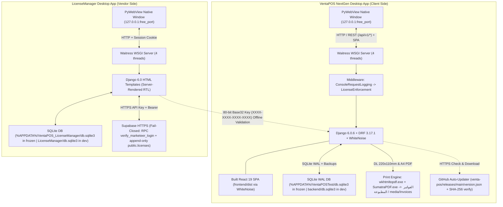

# VentaPOS — Authoritative Engineering Bible (`APP_BIBLE.md`)

> **Status**: Single Source of Truth (SSoT) Engineering Manual for **VentaPOS NextGen** (`v1.0.0`) and **LicenseManager** (`v1.0.0`).  
> **Scope**: Architecture, runtime environments, Django models/services, REST & HTML contracts, React UI/UX architecture, PyInstaller packaging, developer commands, design rationales, verified audit gotchas, and recent change log.

---

## 1. System Overview & Architecture Diagram

This repository houses two independent offline-first Windows desktop applications compiled with PyInstaller (`--windowed --onedir --uac-admin`) on top of embedded Waitress + Django 6 + SQLite + PyWebView:

1. **VentaPOS NextGen (`VentaPOS_NextGen/`)** — An **offline-first back-office desk management application** for a single business owner/manager selling furniture, household appliances, and electronics (`مفروشات، أدوات منزلية، أجهزة كهربائية`). Field salespeople (`مناديب`) write sales in physical paper notebooks; the manager transcribes receipts, purchases, supplier returns, expenses, inventory adjustments, and commissions from the office desk.
2. **VentaPOS LicenseManager (`LicenseManager/`)** — The internal **vendor licensing portal** used by the business owner/marketeers to register customer hardware fingerprints (`Machine ID`), authenticate via **Fail-Closed Supabase `pgcrypto` RPC** (`verify_marketeer_login`), record immutable licenses in append-only `public.licenses`, and deterministically mint 80-bit hardware-bound activation/top-up/recovery codes.

### System Architecture Diagram



### Core Commercial & Architectural Invariants

| Invariant | Specification in Code |
| :--- | :--- |
| **Desk-Only Single User** | Single superuser account (`admin`), `TokenAuthentication` + `SessionAuthentication` (DRF), or empty-password auto-login when `admin` has no usable password. No multi-role RBAC or cloud multi-tenancy inside `VentaPOS_NextGen`. |
| **Multi-Branch Isolation** | Independent branches (`Branch`). Zero inter-branch stock transfers. Active branch passed via `X-Branch-ID` header or `?branch_id=` / `?branch=` query parameter. `Supplier` is also branch-scoped (`branch` FK). |
| **80-Bit Cryptographic Offline Licensing** | `[Signature: 36-bit HMAC-SHA256]` + `[XOR-Masked Data: 44-bit]` = 80 bits encoded into 16 Base32 characters (`CHARSET = "ABCDEFGHJKLMNPQRSTUVWXYZ23456789"`, formatted `XXXX-XXXX-XXXX-XXXX`). Payload packs 32-bit `SHA256(machine_id)[:4]`, 8-bit month offset from `BASE_YEAR = 2025`, and 4-bit zero-indexed `product_id`. |
| **No Barcode / SKU / Fixed Selling Price** | `InventoryItem` has NO `barcode`, `sku`, or `selling_price` columns. Products are resolved via Arabic autocomplete (`name`). Unit sale prices (`unit_price` / `sell_price`) are entered per receipt line. |
| **No Customer Table** | Customers are implicit denormalized text fields on `Receipt` (`customer_name`, `phone_number`, `address`, `area`) backed by relevance-ranked historical autocomplete (`CustomerSuggestionsView`). |
| **Soft Delete Everywhere** | Every active transactional/dimension table in `VentaPOS_NextGen` uses `is_deleted = BooleanField(default=False)` with `ActiveManager` (`objects`) and `AllObjectsManager` (`all_objects`). Hard `obj.delete()` is only called in Demo-to-Production wipe (`LicenseActivateView`) and `LicenseManager` admin/delete views. |
| **Monthly Accounting (`YYYY/MM`)** | Transactions operate on integer `(month, year)` pairs, never daily calendar selectors. Dual numeric `<input>` controls for month and year are used across UI and filters. |
| **The 25th Installment Convention** | `InstallmentPayment.payment_date` always stores day `25` (`datetime.date(year, month, 25)`), starting the month **after** `(sale_month, sale_year)`. |
| **Dual Numeral Formatting Convention** | **App UI**: Western ASCII whole integers (`0-9`, comma thousand separators via `fmtNum`, zero `.00` decimals). **PDF / Print Templates**: Arabic-Indic whole integers (`٠١٢٣٤٥٦٧٨٩`) via `ed2ad` / `to_arabic_numerals` (`ROUND_HALF_UP`). |
| **Selective Desktop Printing** | Entry pages (`POS.jsx`, `PurchaseEntry.jsx`, `ReturnReceipt.jsx`) have **no printing**. Printing is restricted to `SearchReceipts.jsx` & `InstallmentsReport.jsx` (DL `220mm x 110mm` installment slips), `SearchPurchases.jsx` (DL `220mm x 110mm` purchase/return slips), and `ReportsLayout` / `ReportTable` (A4 Portrait/Landscape reports). Cash sales are blocked from receipt printing (`ReceiptViewSet.desktop_print`). |
| **Print-Only Basic Tier (`product_id` 2 & 3)** | Restricts app to Receipt CRUD, Installment Schedule printing, `Dimensions` (branches/salespersons), `Tools` (backup/restore), and `Settings`. Analytical reports, inventory, purchases, suppliers, commissions, adjustments, and expenses are hidden in UI and blocked in middleware (`403 print_only_restricted`). |
| **Pre-License External Data** | Receipts dated before `get_first_production_license_start_date()` (earliest non-demo `ClientLicense` / `LicenseHistory` start month) are free-text only (`products_text` + manual `total_amount`, no `SaleItem`), exempt from quota deduction, and excluded from financial/inventory reports **except** `InstallmentsReport`, `calculate_branch_salespersons_performance` collection commission, and `calculate_cash_drawer_summary` installment `collection_inflow`. |

---

## 2. Repository Map

Post-cleanup active workspace structure under `d:\Projects\VentaPOS\`:

| Path | Role & Key Contents |
| :--- | :--- |
| `d:\Projects\VentaPOS\APP_BIBLE.md` | **This file** — comprehensive technical reference and architectural manual. |
| `d:\Projects\VentaPOS\GEMINI.md` | Root agent system rules, commercial operating rules, red lines, and 5-phase workflow. |
| `d:\Projects\VentaPOS\.agents\AGENTS.md` | Mirror of root architectural/agent behavioral guidelines. |
| `d:\Projects\VentaPOS\.agents\rules\rules.md` | Persistent workspace rules loaded automatically by AI agents. |
| `d:\Projects\VentaPOS\.gitignore` | Tracks active `VentaPOS_NextGen/`, `LicenseManager/`, `.agents/`, `APP_BIBLE.md`, `GEMINI.md`, root `.bat` launchers; ignores `_archive/`, legacy folders, `venv/`, `node_modules/`, `dist/`, `build/`, `*.sqlite3`, `backups/`, `media/`, `*.log`, `*.exe`. |
| `d:\Projects\VentaPOS\Run_VentaPOS_Launcher.bat` | Root desktop launcher: runs `npm.cmd run build` in `VentaPOS_NextGen/frontend/`, then starts `VentaPOS_NextGen/venv/Scripts/python.exe -u launcher.py` (fallback `dist/VentaPOS/VentaPOS.exe`) with live UTF-8 console. |
| `d:\Projects\VentaPOS\Run_LicenseManager_Launcher.bat` | Root desktop launcher: starts `LicenseManager/launcher.py` via `..\VentaPOS_NextGen\venv\Scripts\python.exe` (falls back to `LicenseManager\venv` then `dist\VentaPOS_LicenseManager\VentaPOS_LicenseManager.exe`). |
| `d:\Projects\VentaPOS\_archive\` `[gitignored]` | Retired prototypes (`Desktop/`, `Server/`, `Mobile/`, `django_hybrid_poc/`, `Agents/`, `old_docs/`, `Promo/`, `scratch/`, `legacy_agents_docs/`, `PROJECT.md`, `VENTAPOS_CONTEXT.md`). Strictly off-limits to active runtime/docs. |
| `VentaPOS_NextGen/` | Main desktop POS/Back-Office application root (`launcher.py`, `build_exe.py`, `VentaPOS.spec`, `requirements.md`, `UI_UX_RULES.md`, `TODO.md`, `USER_MANUAL_AR.md`). |
| `VentaPOS_NextGen/backend/` | Django 6.0.6 + DRF backend: `backend/` project config (`settings.py`, `urls.py`, `wsgi.py`, `asgi.py`), `api/` app (`models.py`, `serializers.py`, `urls.py`, `middleware.py`, `print_utils.py`, `tools_views.py`, `logger_views.py`, `views/*.py`, `services/*.py`, `utils/*.py`, `management/commands/init_demo_db.py`, `templates/api/*.html`, `tests/*.py`), plus bundled `bin/` (`wkhtmltox/bin/wkhtmltopdf.exe` + `SumatraPDF.exe`). |
| `VentaPOS_NextGen/frontend/` | React 19 + Vite 8 + Tabler RTL SPA (`package.json`, `vite.config.js`, `index.html`, `public/favicon.svg`, `src/` pages, components, hooks, utils, Vitest `__tests__/`). |
| `VentaPOS_NextGen/e2e/` | Playwright live Chromium end-to-end test suite (`package.json`, `playwright.config.js`, `tests/*.spec.js`). |
| `VentaPOS_NextGen/scripts/` | Automation utilities: `generate_codebase_map.py` (AST parser) and `publish_release.py` (GitHub release + `version.json` uploader). |
| `LicenseManager/` | Vendor licensing portal (`launcher.py`, `build_exe.py`, `manage.py`, `requirements.txt`, `requirements.md`, `TODO.md`, `supabase_schema.sql`, `obfuscate_key.py`, `VALIDATOR.py`, `test_license_manager.py`, `core/`, `licenses/`). |

---

## 3. Dev Mode vs. Frozen (PyInstaller) Runtime Lifecycle

### 3.1 Side-by-Side Runtime Comparison

| Dimension | `VentaPOS_NextGen` — Dev Mode | `VentaPOS_NextGen` — Frozen `.exe` | `LicenseManager` — Dev Mode | `LicenseManager` — Frozen `.exe` |
| :--- | :--- | :--- | :--- | :--- |
| **`sys.frozen`** | `False` | `True` (PyInstaller `--onedir`) | `False` | `True` (PyInstaller `--onedir`) |
| **Bundle Root (`BUNDLE_DIR` / `BASE_DIR`)** | `settings.py`: `BUNDLE_DIR` = `VentaPOS_NextGen/`, `BASE_DIR` = `VentaPOS_NextGen/backend/` | `BUNDLE_DIR = Path(sys._MEIPASS)` (`dist/VentaPOS/_internal/`) | `BASE_DIR` = `LicenseManager/` | `BASE_DIR = Path(sys._MEIPASS)` (`dist/VentaPOS_LicenseManager/_internal/`) |
| **Writable Data Dir (`DB_DIR` / `DATA_DIR`)** | `DB_DIR` = `VentaPOS_NextGen/backend/` | `DB_DIR = %APPDATA%\VentaPOSTest` *(Note: placeholder folder name)* | `DATA_DIR` = `LicenseManager/` | `DATA_DIR = %APPDATA%\VentaPOS_LicenseManager` |
| **SQLite Database Path** | `VentaPOS_NextGen/backend/db.sqlite3` | `%APPDATA%\VentaPOSTest\db.sqlite3` | `LicenseManager/db.sqlite3` | `%APPDATA%\VentaPOS_LicenseManager\db.sqlite3` |
| **Django `DEBUG`** | `True` (`not getattr(sys, 'frozen', False)`) | `False` | `True` *(hardcoded)* | `True` *(hardcoded bug — see Section 9)* |
| **Frontend / Static Delivery** | Vite (`:5173`) proxies `/api` -> `:8000`, OR Django + WhiteNoise serves `frontend/dist/` | `WhiteNoiseMiddleware` (`WHITENOISE_USE_FINDERS=True`) serves `sys._MEIPASS/frontend/dist/` via `/static/` & SPA catch-all `index.html` | Django `DIRS=[]`, `APP_DIRS=True`, `STATIC_URL='static/'` (no WhiteNoise; HTML CDN assets) | Django `APP_DIRS=True` templates from `sys._MEIPASS/licenses/templates/` (CDN Bootstrap & Cairo) |
| **Saved PDFs (`get_save_directory`)** | `MEDIA_ROOT/Invoices` or `backend/media/Invoices` | `%APPDATA%\VentaPOSTest\الفواتير المطبوعة` | N/A | N/A |
| **Print Binaries (`print_utils.py`)** | `backend/bin/wkhtmltox/bin/wkhtmltopdf.exe` & `backend/bin/SumatraPDF.exe` | `sys._MEIPASS/bin/wkhtmltox/bin/wkhtmltopdf.exe` & `sys._MEIPASS/bin/SumatraPDF.exe` | N/A | N/A |
| **Backups & Pre-Boot Restore** | `backend/backups/` & `backend/restore_pending.bin` | `%APPDATA%\VentaPOSTest\backups\` & `%APPDATA%\VentaPOSTest\restore_pending.bin` | None | None |
| **Logs & Streams** | `backend/ventapos_system.log` + `backend/logs/frontend_console.log` + real console `stdout/stderr` | `%APPDATA%\VentaPOSTest\ventapos_system.log` + `logs/frontend_console.log` + `DummyWriter` stubbing `None` streams | Real console `stdout/stderr` (`[BACKEND]` middleware) | `DummyWriter` stubbing `None` streams (no log file configured) |
| **Webview Debug Mode** | `webview.start(debug=True)` (DevTools enabled) | `webview.start(debug=False)` | `webview.start(debug=True)` | `webview.start(debug=False)` |

### 3.2 Boot Sequence (`launcher.py` in Both Apps)

1. **Stream Guard**: Defines `DummyWriter` (`write`/`flush` no-ops) whenever `sys.stdout is None` or `sys.stderr is None` (mandatory in PyInstaller `--windowed` GUI builds).
2. **Venv Auto Re-Exec (Dev Only)**:
   - `VentaPOS_NextGen/launcher.py`: if `not sys.frozen` and `sys.prefix == sys.base_prefix`, re-launches with `VentaPOS_NextGen/venv/Scripts/python.exe`.
   - `LicenseManager/launcher.py`: if `not sys.frozen` and importing `waitress`, `webview`, or `requests` fails, re-launches with `../VentaPOS_NextGen/venv/Scripts/python.exe`.
3. **Ephemeral Port Allocation**: `get_free_port()` binds `'127.0.0.1', 0`, reads the OS-assigned port, closes the socket, and constructs `url = http://127.0.0.1:<port>`.
4. **PyWebView Splash & Window**: Opens maximized `1280x800` (`min_size=(1024, 768)`) RTL Arabic loading spinner HTML (`window = webview.create_window(...)`) and attaches `window.events.closing += on_closing`, which triggers a native Windows Win32 `MessageBoxW` (`MB_YESNO | MB_ICONWARNING | MB_RTLREADING | MB_RIGHT | MB_TOPMOST`) close confirmation.
5. **Background Initialization (`background_init`)**:
   - **VentaPOS NextGen (`setup_database`)**:
     1. Calls `check_pending_restore()`: if `DB_DIR/restore_pending.bin` exists, runs SQLite `PRAGMA integrity_check;`; if `"ok"`, snapshots current DB to `backups/pre_pending_restore_<ts>.sqlite3`, copies `restore_pending.bin` over `db.sqlite3`, deletes `-wal` and `-shm` sidecars, and deletes `restore_pending.bin`.
     2. Calls `django.setup()`.
     3. Creates pre-migration hot backup using `sqlite3.backup()` -> `DB_DIR/backups/auto_backup_<YYYYMMDD_HHMMSS>.sqlite3`, pruning to keep only the **10 most recent** `auto_backup_*.sqlite3` files.
     4. Runs `call_command('migrate', interactive=False)`. On failure, automatically rolls back `db.sqlite3` to the latest `auto_backup_*.sqlite3`, removes `-wal`/`-shm`, displays an RTL Arabic error HTML card inside the PyWebView window, and aborts Waitress startup.
     5. Runs `call_command('init_demo_db')`.
   - **LicenseManager (`setup_database`)**: Calls `django.setup()` and `call_command('migrate', interactive=False)`.
6. **Waitress Server & Redirect**: Spawns daemon thread running `waitress.serve(application, host='127.0.0.1', port=port, threads=4)`. Main init thread polls `GET http://127.0.0.1:<port>` every `0.5s` for up to `30s` until `200`, then calls `window.load_url(url)`.

### 3.3 Application Lifecycle (`Demo -> Activation -> Production`) & Auto-Updater

- **Demo Mode (`init_demo_db.py`)**: Runs on every launch **unless** a non-demo `ClientLicense` (`exclude(machine_id="DEMO_MACHINE")`) exists. When in Demo mode, wipes all tables inside `transaction.atomic()`, creates superuser `admin` (empty password `""`), company settings (`شركة الأمل للتجارة والأجهزة`), 2 branches (`الفرع الرئيسي`, `فرع المعادي`), 4 salespersons per branch, 10 suppliers per branch, `74` household/furniture/electronics products per branch, `DEMO_MACHINE` `product_id=7` license (`invoices_balance=999999`), and generates **25 months** of sales/purchases/installments/expenses/deficits (`120` receipts per month per branch, ~1% cash, ~99% installment).
- **Activation (`LicenseActivateView`)**: Accepting any valid production base plan (`product_id` 1–7) while `is_demo` is true **hard-deletes** all Demo rows (`Expense`, `InventoryAdjustment`, `LicenseHistory`, `InstallmentPayment`, `SaleItem`, `Receipt`, `PurchaseInvoiceItem`, `PurchaseInvoice`, `CommissionHistory`, `InventoryItem`, `Supplier`, `Salesperson`, `Branch`, `CompanySetting`, `ClientLicense`, `UsedLicense`), inserts the production `ClientLicense` with HMAC `license_code_hash`, logs `UsedLicense` + `LicenseHistory`, and prompts the React UI to redirect to `/activation-setup`.
- **Auto-Updater (`SystemCheckUpdateView` & `SystemApplyUpdateView`)**:
  - `GET /api/v1/system/check-update/` fetches `RELEASES_MANIFEST_URL` (`https://raw.githubusercontent.com/venta-pos/releases/main/version.json`, 5s timeout) and compares semantic version against `settings.APP_VERSION` (`"1.0.0"`). Gracefully returns `offline: True` if unreachable.
  - `POST /api/v1/system/apply-update/` enforces `is_authorized_for_maintenance(request)`, rejects URLs outside `ALLOWED_PREFIXES` (`https://github.com/venta-pos/releases/`, `https://raw.githubusercontent.com/venta-pos/releases/`), requires non-empty `sha256`, downloads to `%TEMP%/VentaPOS_Update/VentaPOS_Setup_v<version>.exe`, verifies SHA-256 checksum, launches `subprocess.Popen([installer_file])`, and when `sys.frozen` is true, spawns a daemon timer thread (`1.0s` delay -> `os._exit(0)`) so the installer can replace files cleanly.

---

## 4. Backend Reference (Django)

### 4.1 Settings, Middleware & Environment Variables

#### `VentaPOS_NextGen/backend/backend/settings.py`
- **`INSTALLED_APPS`**: `django.contrib.admin`, `django.contrib.auth`, `django.contrib.contenttypes`, `django.contrib.sessions`, `django.contrib.messages`, `django.contrib.staticfiles`, `rest_framework`, `rest_framework.authtoken`, `corsheaders`, `api`.
- **`MIDDLEWARE` (exact order)**:
  1. `django.middleware.security.SecurityMiddleware`
  2. `whitenoise.middleware.WhiteNoiseMiddleware`
  3. `api.middleware.ConsoleRequestLoggingMiddleware`
  4. `corsheaders.middleware.CorsMiddleware`
  5. `django.contrib.sessions.middleware.SessionMiddleware`
  6. `django.middleware.common.CommonMiddleware`
  7. `django.middleware.csrf.CsrfViewMiddleware`
  8. `django.contrib.auth.middleware.AuthenticationMiddleware`
  9. `django.contrib.messages.middleware.MessageMiddleware`
  10. `django.middleware.clickjacking.XFrameOptionsMiddleware`
  11. `api.middleware.LicenseEnforcementMiddleware`
- **Database (`SQLite`)**: `NAME: DB_DIR / 'db.sqlite3'`, `OPTIONS`: `timeout: 20`, `check_same_thread: False`, `init_command: 'PRAGMA journal_mode=WAL; PRAGMA synchronous=NORMAL; PRAGMA cache_size=-64000;'`.
- **DRF**: `DEFAULT_AUTHENTICATION_CLASSES = ['rest_framework.authentication.TokenAuthentication', 'rest_framework.authentication.SessionAuthentication']`; `DEFAULT_PERMISSION_CLASSES = ['rest_framework.permissions.IsAuthenticated']`.
- **CORS**: `CORS_ALLOW_ALL_ORIGINS = True`; `CORS_ALLOW_HEADERS` adds `x-machine-id` and `x-branch-id`.
- **Release & Logging Constants**: `APP_VERSION = "1.0.0"`, `RELEASES_REPO = "venta-pos/releases"`, `RELEASES_MANIFEST_URL = "https://raw.githubusercontent.com/venta-pos/releases/main/version.json"`; `LOGGING` routes `django` and `api` (`INFO`) to `DB_DIR / 'ventapos_system.log'` (`FileHandler`) and `StreamHandler`. Frontend logs rotate separately in `DB_DIR / 'logs/frontend_console.log'` (`5 MB x 2` backups via `logger_views.py`).
- **Time Zone**: `TIME_ZONE = 'UTC'`, `USE_I18N = True`, `USE_TZ = True`.
- **Secret Handling**: `settings.SECRET_KEY` has a hardcoded development fallback literal in `settings.py`; cryptographic license & receipt HMAC keys are loaded at runtime via `LicenseValidator._get_key()` byte obfuscation (`api/utils/license_validator.py`).

#### `LicenseManager/core/settings.py`
- **`INSTALLED_APPS`**: `django.contrib.admin`, `django.contrib.auth`, `django.contrib.contenttypes`, `django.contrib.sessions`, `django.contrib.messages`, `django.contrib.staticfiles`, `licenses`.
- **`MIDDLEWARE`**: Django defaults + `licenses.middleware.ConsoleRequestLoggingMiddleware` right after `SecurityMiddleware`.
- **Environment Variables & Settings**:
  - `APPDATA`: resolves frozen `DATA_DIR` (`%APPDATA%\VentaPOS_LicenseManager`).
  - `SUPABASE_URL`, `SUPABASE_KEY`, `MARKETEER_ID`: read from `os.environ` with **hardcoded fallback defaults present in `core/settings.py`** (`SUPABASE_URL`, `SUPABASE_KEY`, and `MARKETEER_ID="default_marketeer"`). Never store or print raw `SUPABASE_KEY` or `SECRET_KEY` literals in documentation.
  - `VENTA_LICENSE_MASTER_PASSWORD` (`settings.MASTER_PASSWORD`): **dead/unused legacy env var** left in `core/settings.py` after migrating login to Supabase `verify_marketeer_login`.
  - `LicenseGenerator.SECRET_KEY` (`licenses/utils/crypto.py`): hardcoded raw byte secret matching `VentaPOS_NextGen`'s `LicenseValidator._get_key()`.
  - `GITHUB_TOKEN`: read from env in `VentaPOS_NextGen/scripts/publish_release.py`.

---

### 4.2 Data Model Catalog — `VentaPOS_NextGen` (`backend/api/models.py`, 16 Active Models)

All 16 models inherit soft-delete filtering via `objects = ActiveManager()` (`is_deleted=False`) and `all_objects = AllObjectsManager()`. No UUID PKs are used on any model. Sync metadata columns (`source`, `sync_action`, `is_confirmed`, `is_synced`, `device_token`, `is_device_active`, `client_uuid`) exist on schemas for dormant offline-sync compatibility.

| # | Model (`db_table`) | Fields (Types, Constraints, Defaults) | Relationships (`FK` / `on_delete` / `related_name`) | Constraints, Indexes & Key Methods |
| :-: | :--- | :--- | :--- | :--- |
| 1 | `Branch` (`salesapp_branch`) | `name` `CharField(150, unique)`, `source` (`"DESKTOP"`), `sync_action` (`"NEW"`), `is_confirmed` (`True`), `is_synced` (`False`), `is_deleted` (`False`), `created_at` | Target of FKs from `Salesperson`, `InventoryItem`, `Supplier`, `PurchaseInvoice`, `Receipt`, `Expense` | `unique` on `name` |
| 2 | `Salesperson` (`salesapp_salesperson`) | `name` `CharField(100)`, `device_token` `UUIDField(null/blank)`, `is_device_active` (`False`), `source`, `sync_action`, `is_confirmed`, `is_synced`, `is_deleted`, `created_at` | `branch` -> `Branch` (`PROTECT`, `related_name="salespeople"`) | `UniqueConstraint(fields=["name", "branch"], name="uq_salesperson_name_branch")` |
| 3 | `InventoryItem` (`salesapp_inventoryitem`) | `name` `CharField(200)`, `initial_quantity` `PositiveIntegerField(0)`, `initial_purchase_price` `DecimalField(12,2, 0.00)`, `initial_commission_amount` `DecimalField(12,2, 0.00)`, `initial_month` `PositiveIntegerField(1, 1..12)`, `initial_year` `PositiveIntegerField(2026, >=2025)`, sync cols, `is_deleted`, `created_at`, `updated_at` | `branch` -> `Branch` (`PROTECT`, `related_name="inventory_items"`) | `uq_inventory_item_name_branch` (`name`, `branch`); `idx_inv_item_branch_name`; `ordering=['name']`. Methods: `get_stock_at_date(m, y)`, `get_commission_at_date(m, y)`, `get_price_at_date(m, y)`, `get_safe_available_qty(...)` |
| 4 | `CommissionHistory` (`salesapp_commissionhistory`) | `commission_amount` `DecimalField(12,2)`, `activation_month` (`1..12`), `activation_year` (`>=2025`), sync cols, `is_deleted`, `created_at` | `item` -> `InventoryItem` (`CASCADE`, `related_name="commission_records"`) | `uq_comm_hist_item_date` (`item`, `activation_month`, `activation_year`); `ordering=['-activation_year', '-activation_month']` |
| 5 | `InventoryAdjustment` (`salesapp_inventoryadjustment`) | `adjustment_type` `CharField(10, choices=[("DEFICIT", "عجز (-)")], default="DEFICIT")`, `quantity` `PositiveIntegerField`, `reason` `CharField(255, null/blank)`, `month` (`1..12`), `year` (`>=2025`), sync cols, `is_deleted`, `created_at` | `item` -> `InventoryItem` (`CASCADE`, `related_name="adjustments"`) | `idx_adj_item_date` (`item`, `year`, `month`); `ordering=['-year', '-month', '-id']` |
| 6 | `Supplier` (`salesapp_supplier`) | `name` `CharField(200)`, sync cols, `is_deleted`, `created_at` | `branch` -> `Branch` (`PROTECT`, `null=True, blank=True`, `related_name="suppliers"`) | `uq_supplier_name_branch` (`name`, `branch`) |
| 7 | `PurchaseInvoice` (`salesapp_purchaseinvoice`) | `invoice_number` `PositiveIntegerField(null/blank)`, `invoice_type` `CharField(20, choices=[("PURCHASE","فاتورة شراء"),("RETURN","فاتورة مرتجع")], default="PURCHASE")`, `invoice_month` (`db_index`, `1..12`), `invoice_year` (`db_index`, `>=2025`), sync cols, `is_deleted`, `created_at` (`db_index`) | `branch` -> `Branch` (`PROTECT`, `related_name="purchase_invoices"`); `supplier` -> `Supplier` (`PROTECT`, `related_name="purchase_invoices"`) | `uq_pur_inv_branch_num_supp` (`branch`, `invoice_number`, `supplier`); `ordering=['-invoice_year', '-invoice_month', '-id']` |
| 8 | `PurchaseInvoiceItem` (`salesapp_purchaseinvoiceitem`) | `quantity` `PositiveIntegerField(1)`, `purchase_price` `DecimalField(12,2, default=0.00, null/blank)`, sync cols, `is_deleted`, `created_at` | `invoice` -> `PurchaseInvoice` (`CASCADE`, `related_name="items"`); `inventory_item` -> `InventoryItem` (`PROTECT`, `related_name="purchaseinvoiceitem_set"`) | — |
| 9 | `Receipt` (`salesapp_receipt`) | `receipt_type` `CharField(20, default="SALE")` (`SALE`/`RETURN`), `receipt_number` `PositiveIntegerField(db_index, null/blank)`, `client_uuid` `UUIDField`, `receipt_hash` `CharField(64, null/blank)`, `customer_name` `CharField(150, db_index, null/blank)`, `phone_number` `CharField(20, db_index, null/blank)`, `address` `CharField(255, null/blank)`, `area` `CharField(100, db_index, null/blank)`, `total_amount` `DecimalField(12,2, 0.00)`, `down_payment` `DecimalField(12,2, 0.00)`, `installment_system` `CharField(200, null/blank)`, `sale_year` `PositiveIntegerField(db_index)`, `sale_month` `PositiveIntegerField(db_index)`, `is_cash_sale` (`False`), `products_text` `TextField(null/blank)`, sync cols, `is_deleted`, `created_at` (`db_index`), `updated_at` | `parent_receipt` -> `self` (`CASCADE`, `null/blank`, `related_name="child_receipts"`); `branch` -> `Branch` (`PROTECT`, `related_name="receipts"`); `salesperson` -> `Salesperson` (`PROTECT`, `null/blank`, `related_name="receipts"`) | `uq_receipt_branch_number` (`branch`, `receipt_number`); 4 indexes: `idx_receipt_branch_date`, `idx_receipt_hash`, `idx_rcpt_br_type_date`, `idx_rcpt_parent_type`; `ordering=['-receipt_number']`. Methods: `get_next_receipt_number(branch)`, `@property is_authentic` (verifies item-bound + legacy HMAC-SHA256) |
| 10 | `SaleItem` (`salesapp_saleitem`) | `quantity` `PositiveIntegerField(1)`, `unit_price` `DecimalField(12,2)`, sync cols, `is_deleted`, `created_at` | `receipt` -> `Receipt` (`CASCADE`, `related_name="sale_items"`); `inventory_item` -> `InventoryItem` (`PROTECT`, `related_name="saleitem_set"`) | — |
| 11 | `InstallmentPayment` (`salesapp_installmentpayment`) | `payment_date` `DateField`, `amount` `DecimalField(12,2)`, `is_deleted`, `created_at` | `receipt` -> `Receipt` (`CASCADE`, `related_name="payments"`) | 2 indexes: `idx_inst_payment_date` (`payment_date`), `idx_inst_receipt_date` (`receipt`, `payment_date`) |
| 12 | `Expense` (`salesapp_expense`) | `category` `CharField(100, blank, default="مصروفات عامة", db_index)`, `amount` `DecimalField(12,2)`, `description` `CharField(255)`, `expense_year` `IntegerField`, `expense_month` `IntegerField`, sync cols, `is_deleted`, `created_at` | `branch` -> `Branch` (`CASCADE`, `related_name="expenses"`) | `idx_exp_branch_date` (`branch`, `expense_year`, `expense_month`) |
| 13 | `CompanySetting` (`salesapp_companysetting`) | `name` `CharField(100)`, `description` `CharField(200, null/blank)`, `phone1` `CharField(20)`, `phone2` `CharField(20, null/blank)`, `footer_text` `CharField(250, default="تطبق الشروط والأحكام")`, `collection_commission_rate` `DecimalField(5,2, default=0.10)`, `zoom_level` `DecimalField(4,2, default=1.00)`, sync cols, `is_deleted`, `created_at` | None | Singleton `save()` reuses `CompanySetting.objects.first().pk` |
| 14 | `ClientLicense` (`salesapp_clientlicense`) | `product_id` `IntegerField`, `start_date` `DateField(null/blank)`, `expiry_date` `DateField(null/blank)`, `invoices_balance` `PositiveIntegerField(0)`, `is_active` (`True`), `machine_id` `CharField(255, null/blank)`, `company_code` `IntegerField(null/blank)`, `license_code_hash` `CharField(64, null/blank)`, `last_checkin` (`auto_now`), `is_deleted`, `created_at` | None | HMAC-signed via `generate_record_signature(...)` |
| 15 | `UsedLicense` (`salesapp_usedlicense`) | `code_hash` `CharField(64, unique)`, `used_at` (`auto_now_add`), `is_deleted` | None | Prevents code replay (`canonical_code_hash` + raw SHA-256 fallback) |
| 16 | `LicenseHistory` (`salesapp_licensehistory`) | `machine_id` `CharField(100)`, `product_name` `CharField(100)`, `operation_type` `CharField(50, default="تجديد/تفعيل")`, `start_date` `DateField(null/blank)`, `end_date` `DateField(null/blank)`, `added_balance` `IntegerField(0)`, `archived_at` (`auto_now_add`), `status` `CharField(50, default="أرشيف")`, `is_deleted` | None | Audit log of activations, top-ups, and emergency recoveries |

> Note: Line 681 of `models.py` contains only a placeholder comment `# 17. PendingExternalReceipt`; no model #17 is implemented.

---

### 4.3 Data Model & Supabase Schema — `LicenseManager`

#### Local Django Models (`LicenseManager/licenses/models.py`)
- **`Client`**: `name` (`CharField(100)`), `phone` (`CharField(20)`), `machine_id` (`CharField(100, unique=True)` — validated by `ClientForm.clean_machine_id` as `^[a-f0-9]{32}$`), `store_name` (`CharField(100, null/blank)`), `is_banned` (`BooleanField(default=False)`), `created_at`.
- **`License`**: `client` (`FK -> Client`, `CASCADE`, `related_name='licenses'`), `product_id` (`IntegerField(choices=PRODUCT_CHOICES)`), `price` (`IntegerField(default=0)`), `notes` (`TextField(null/blank)`), `start_date` (`DateField(default=timezone.now)`), `generated_code` (`CharField(20, editable=False)` — auto-generated in `save()` via `LicenseGenerator.generate(...)`), `created_at`, `is_active` (`BooleanField(default=True)`).

#### Product Tiers (1–16) & NextGen vs. LicenseManager Behavior
*(Note: `LicenseForm.__init__` hides `product_id` `8` and `9` from the LicenseManager UI).*

| `product_id` | Arabic Label (`License.PRODUCT_CHOICES`) | NextGen `LicenseActivateView` Effect (`expiry_date` / `invoices_balance`) | LicenseManager `get_duration_days()` / `get_expiry_date()` |
| :-: | :--- | :--- | :--- |
| `1` | `تجربة مجانية (Trial 60 Days)` | `start + 2 months` (day 1) / `+800` | `60` days (`start_date + timedelta(60)`) |
| `2` | `طباعة فقط - سنة واحدة` | `start_year + 1` (day 1) / `+4,800` + **Print-Only** | `365` days (`start_date + timedelta(365)`) |
| `3` | `طباعة فقط - مدى الحياة` | `start_year + 99` (day 1) / `+999,999` + **Print-Only** | `365 * 99` (`get_expiry_date()` returns `None`) |
| `4` | `إدارة كاملة - سنة واحدة` | `start_year + 1` (day 1) / `+4,800` | `365` days |
| `5` | `إدارة كاملة - 3 سنوات` | `start_year + 3` (day 1) / `+14,400` | `1,095` days (`365 * 3`) |
| `6` | `إدارة كاملة - 5 سنوات` | `start_year + 5` (day 1) / `+24,000` | `1,825` days (`365 * 5`) |
| `7` | `إدارة كاملة - مدى الحياة (VIP)` | `start_year + 99` (day 1) / `+999,999` | `365 * 99` (`get_expiry_date()` returns `None`) |
| `8`–`9` | `إضافة الأونلاين - سنة` / `5 سنوات` | Defaults to `+1 yr / 4,800` in NextGen (`LicenseForm` excludes 8–9) | `365` / `1,825` days |
| `10`–`15` | `كود شحن` (`100` / `300` / `500` / `1000` / `3000` / `5000` فاتورة) | **Top-up** active prod `ClientLicense.invoices_balance` (`10->100, 11->300, 12->500, 13->1000, 14->3000, 15->5000`); no expiry change | `0` days (`None`) |
| `16` | `كود استعادة كلمة المرور للمدير (طوارئ)` | Rejected on `/license/activate/`; accepted once by `POST /api/v1/auth/recover/` (`is_recovery=True`) | `0` days (`None`) |

#### Supabase PostgreSQL Cloud Schema (`LicenseManager/supabase_schema.sql`)
- **`public.licenses`**: Append-only ledger (`id`, `marketeer_id`, `client_name`, `client_phone`, `store_name`, `machine_id`, `product_id`, `product_name`, `license_code` UNIQUE, `price`, `start_date`, `expiry_date`, `created_at`), 7 B-Tree indexes, RLS policies allowing `SELECT` + `INSERT` for `anon, authenticated`, **no `UPDATE`/`DELETE` policies**, and `BEFORE UPDATE OR DELETE` trigger `trg_prevent_license_tamper` calling `prevent_license_tamper()`.
- **`public.marketeer_users`**: Extension `pgcrypto`; stores `username` (UNIQUE), `password_hash` (`crypt(..., gen_salt('bf'))`), `full_name`, `is_active`. RLS enabled with `REVOKE ALL` from `anon, authenticated`.
- **`public.verify_marketeer_login(p_username TEXT, p_password TEXT)`**: `SECURITY DEFINER` RPC comparing `LOWER(username) = LOWER(TRIM(p_username))` and `password_hash = crypt(p_password, password_hash)` where `is_active = TRUE`. Returns `{"ok": true, "username", "full_name"}` or `{"ok": false}`. Executable by `anon, authenticated`.

---

### 4.4 Auth, Permissions & Middleware Guards

- **DRF Global Auth**: Requires `Token <key>` or Django session, except explicit `permission_classes = [AllowAny]` endpoints: `/auth/local/`, `/auth/demo/`, `/auth/recover/`, `/license/status/`, `/license/activate/`, `/frontend-logs/`, `/system/check-update/`, `/system/apply-update/`, and `/tools/backup/upload/`.
- **`is_authorized_for_maintenance(request)` (`api/utils/security_utils.py`)**: Protects `BackupUploadView` and `SystemApplyUpdateView`. Allows if `request.user.is_authenticated`, **OR** system is in Demo mode (no non-demo `ClientLicense`), **OR** superuser has no usable/empty password.
- **`LicenseEnforcementMiddleware` (`api/middleware.py`)**:
  1. **Whitelist**: Bypasses `/admin/`, `/static/`, `/api/v1/license/`, `/api/v1/tools/backup/`, `/api/v1/auth/`, `/api/v1/frontend-logs/`, `/api/v1/system/`.
  2. **Demo Bypass**: If no production `ClientLicense` (`exclude(machine_id="DEMO_MACHINE")`) exists, skips enforcement.
  3. **Clock-Rollback Guard**: Rejects (`403 clock_rollback`) if `timezone.now()` precedes latest production `ClientLicense.created_at - 5 min` or latest `Receipt.created_at - 5 min`.
  4. **HMAC Integrity Check**: Reads 24h-cached `machine_id` (Windows Registry `HKLM\SOFTWARE\Microsoft\Cryptography\MachineGuid` SHA-256[:32]), recomputes `generate_record_signature(...)` for every active `ClientLicense`, and immediately sets `is_active=False` on mismatch.
  5. **Print-Only Restriction (`product_id in (2, 3)`)**: Blocks (`403 print_only_restricted`) paths starting with `/api/v1/reports/`, `/api/v1/inventory-items/`, `/api/v1/purchase-invoices/`, `/api/v1/purchase-invoice-items/`, `/api/v1/expenses/`, `/api/v1/suppliers/`, `/api/v1/commission-histories/`, `/api/v1/inventory-adjustments/`.
  6. **Expiry Lock**: Computes `(start_date, last_allowed_month, grace_end)` via `get_license_date_bounds` (day-1 expiry sets `last_allowed_month = expiry - 1 month`, `grace_end = expiry.replace(day=25)`). Beyond `grace_end`, blocks all `POST`/`PUT`/`DELETE`/`PATCH` (`403 license_expired`).
  7. **Quota Exhaustion**: On `POST /api/v1/receipts/`, if `total_invoices_balance <= 0`, blocks (`403 license_expired`) **unless** `(sale_year, sale_month)` precedes `get_first_production_license_start_date()` (pre-license exemption).
- **`LicenseManager` Auth**: Session keys (`request.session['is_logged_in']`, `marketeer_username`, `marketeer_full_name`) checked by `is_authenticated(request)`; login fails closed against Supabase RPC. `add_license_view` also rejects `client.is_banned` and fails closed if Supabase `POST /rest/v1/licenses` fails.

---

### 4.5 Services, Print Utilities, Management Commands & Background Threads

- **`api/services/stock_service.py`**:
  - `calculate_bulk_stock_timeline(items, target_month, target_year, default_month, default_year)`: Computes month-by-month stock using **3 grouped SQL queries** (`PurchaseInvoiceItem`, `SaleItem`, `InventoryAdjustment`) clamped via `max(0, ...)` at each month: `initial_qty + purchases + sales_returns - sales - purchase_returns - deficit`. Returns `safe_available_qty` (bottleneck minimum future stock from target month through max horizon `max((now), (default), last_event)`) plus `bottleneck_month` / `bottleneck_year`.
  - `get_bulk_price_resolver` & `get_bulk_commission_resolver`: In-memory resolvers returning latest buying price / commission at `(month, year)` falling back to `initial_purchase_price` / `initial_commission_amount`.
- **`api/services/financial_service.py`**:
  - `get_collection_commission_rate()`: Reads singleton `CompanySetting.collection_commission_rate` (normalizes `> 1.0` percentages by `/ 100.0`, defaults `0.10`).
  - `calculate_upfront_credit_reserve(credit_receipts, credit_returns, coll_rate)`: `max(0.0, (credit_rev - down_payments) - credit_returns_rev) * coll_rate`.
  - `calculate_cash_drawer_summary(branch_id, month, year, auto_salaries)`: Computes 10-point inflows (`cash_sales_inflow`, `down_payment_inflow` — both zeroed in pre-license months — plus `collection_inflow` from `InstallmentPayment` including pre-license receipts, plus `purchase_returns_total`) minus outflows (`operating_expenses`, `auto_salaries`, `total_purchases`, `sales_returns_cash`).
  - `calculate_deficit_loss(branch_id, month, year, price_resolver)`: Sums `adj.quantity * price_at_date(item, month, year)`.
- **`api/services/compensation_service.py`**: `calculate_branch_salespersons_performance(...)` calculates per-salesperson `receipts_count`, cash/credit sales net of returns (anchored to parent receipt month when `parent_receipt` exists), `comm_sales` (`مندبة`), `comm_coll` (`collected * coll_rate`, covering pre-license installment collections too), and `due_salary = comm_sales + comm_coll`.
- **`api/services/receipt_service.py`**: `create_receipt`, `update_receipt`, `process_return_receipt`, `get_next_receipt_number(branch, select_for_update)`, license bound helpers (`get_active_license`, `get_first_production_license_start_date`, `is_pre_license_month`, `get_license_date_bounds`, `get_subscription_date_bounds`). Enforces payment balance tolerance `abs(total - (down + installments)) <= 0.01`, future-bottleneck stock validation, FIFO-ordered `ClientLicense` quota deduction (`order_by('expiry_date', 'id')`), deterministic HMAC-SHA256 `receipt_hash`, and atomic return creation (`receipt_type='RETURN'`, parent receipt link, proportional installment/refund adjustments).
- **`api/services/purchase_service.py`**: `validate_items_stock_integrity`, `create_purchase_invoice`, `update_purchase_invoice` (validates purchase updates/returns against future stock bottlenecks, auto-assigns `invoice_number` per branch/supplier, syncs line items atomically).
- **`api/print_utils.py`**: `to_arabic_numerals` / `ed2ad` (`ROUND_HALF_UP` whole integer rounding + `0-9 -> ٠-٩`), `to_english_numerals`, `get_num_to_words_ar` (via `num2words(..., lang='ar')` with fallback `str(amount)`), `get_wkhtmltopdf_config()`, `get_save_directory()`, `generate_and_open_pdf(...)` (`A4` 10mm margins Portrait/Landscape vs `DL` `220mm x 110mm` 0mm margins; `time.sleep(1)`; opens via `os.startfile` when `action="view"`, or spawns `SumatraPDF.exe -print-to <printer>|-print-to-default -silent` with `CREATE_NO_WINDOW` when `action="print"`). *(Note: `clean_invoices_directory()` is defined at L10–18 but never called).*
- **Management Commands / Signals / Threads**:
  - Single custom management command: `python manage.py init_demo_db` (`api/management/commands/init_demo_db.py`).
  - Django Signals: **None** (`apps.py` registers no signals; all side effects live in serializers/services).
  - Background Threads: `launcher.py` (`background_init`, Waitress server thread), and `SystemApplyUpdateView.post` (`1.0s` daemon `_delayed_exit` -> `os._exit(0)` when frozen).

---

## 5. API Contract Map

### 5.1 `VentaPOS_NextGen` DRF Router ViewSets (`/api/v1/`)

All endpoints below require `Token` or `Session` auth and pass `LicenseEnforcementMiddleware` unless noted. Pagination (`PageNumberPagination` where enabled) uses `page_size=200` (`?page_size=`, `max_page_size=1000`). Branch scope comes from `X-Branch-ID` or `?branch_id=`/`?branch=`.

| Method(s) | Path (`/api/v1/...`) | View / Serializer | Request Shape | Response Shape | Calling React File(s) |
| :--- | :--- | :--- | :--- | :--- | :--- |
| `GET, POST, PATCH, PUT, DELETE` | `company-settings/` (`{id}/`) | `CompanySettingViewSet` / `CompanySettingSerializer` | `{name, description, phone1, phone2, footer_text, collection_commission_rate, zoom_level, admin_password?}` | Singleton `CompanySetting` JSON (list `[setting]` or object) | `Navbar.jsx`, `Login.jsx`, `CompanyTab.jsx`, `ActivationSetup.jsx` |
| `GET, POST, PATCH, DELETE` | `branches/` (`{id}/`) | `BranchViewSet` / `BranchSerializer` | `{name}` | Branch object(s); `DELETE` returns `400` if linked to receipts/purchases/items/expenses | `Navbar.jsx`, `BranchSelection.jsx` |
| `GET, POST, PUT, PATCH, DELETE` | `salespersons/` (`{id}/`) | `SalespersonViewSet` / `SalespersonSerializer` | `?branch_id=`, `?search=`; `{name, branch}` | Salesperson list/object; `DELETE` blocked if linked to receipts | `SalespersonsTab.jsx`, `POS`, `SearchReceipts.jsx`, reports, `useSalespersons.js` *(unused)* |
| `GET, POST, PUT, PATCH, DELETE` | `inventory-items/` (`{id}/`) | `InventoryItemViewSet` / `InventoryItemSerializer` | `?branch_id=`, `?search=`, `?limit=`; `{name, branch, initial_quantity, initial_purchase_price, initial_commission_amount, initial_month, initial_year}` *(year >= 2025)* | Item JSON with precomputed `current_stock`; Print-Only blocked | `InventoryTab.jsx`, `ProductLedger.jsx`, `PurchaseEntry.jsx`, `PurchasesReport.jsx`, `usePOSDataLoader.js` |
| `GET` | `inventory-items/{id}/stock/` & `inventory-items/{id}/get_safe_available_qty/` | `InventoryItemViewSet.safe_available_qty` / `get_safe_available_qty` | `?month=`, `?year=` (`2000..2100`) | `{safe_available_qty, bottleneck_month?, bottleneck_year?}` | `POSItemsTable.jsx`, `usePOSSuggestions.js`, `posUtils.js`, `PurchaseEntry.jsx`, `PurchaseItemForm.jsx`, `purchaseUtils.js` |
| `GET` | `inventory-items/pos_search/` | `InventoryItemViewSet.pos_search` | `?term=` (<=20 matches) | `[{id, name}]` | *(No active frontend caller — see §5.5)* |
| `GET` | `inventory-items/{id}/ledger/` | `InventoryItemViewSet.ledger` | Path `{id}` | `{item, item_info, timeline[], monthly_summary[], dashboard_metrics}` | `ProductLedger.jsx` |
| `GET, POST, DELETE` | `commission-histories/` & `commission-history/` | `CommissionHistoryViewSet` / `CommissionHistorySerializer` | `?item_id=`; `{item, commission_amount, activation_month, activation_year}` *(year >= 2025; upserts existing month)* | `CommissionHistory` JSON (`200` on upsert, `201` on new) | `ProductLedger.jsx` (`commission-histories/`) |
| `GET, POST, DELETE` | `inventory-adjustments/` (`{id}/`) | `InventoryAdjustmentViewSet` / `InventoryAdjustmentSerializer` | `?item_id=`; `{item|inventory_item, adjustment_type:"DEFICIT", quantity, reason, month|adjustment_month, year|adjustment_year}` | Validates `qty <= safe_limit`; Print-Only blocked | `ProductLedger.jsx` |
| `GET, POST, PUT, DELETE` | `suppliers/` (`{id}/`) | `SupplierViewSet` / `SupplierSerializer` | `?branch_id=`, `?search=`, `?limit=`; `{name, branch?}` | Supplier list/object (`branch_name`); Print-Only blocked | `SuppliersTab.jsx`, `SearchPurchases.jsx`, `PurchasesReport.jsx`, `purchaseUtils.js` |
| `GET, POST, PUT, PATCH, DELETE` | `purchase-invoices/` (`{id}/`) | `PurchaseInvoiceViewSet` (`PurchaseInvoicePagination`) / `PurchaseInvoiceSerializer` | `?supplier=`, `?invoice_number=`, `?month=`, `?year=`, `?invoice_type=ALL\|PURCHASE\|RETURN`; `{branch, supplier, invoice_number?, invoice_type, invoice_month, invoice_year, items[]}` | Paginated `{count, next, previous, aggregate:{total_purchases}, all_ids[], results[]}`; `DELETE` checks future stock safety | `SearchPurchases.jsx`, `PurchaseEntry.jsx`, `purchaseUtils.js` |
| `POST` | `purchase-invoices/desktop_print/` | `PurchaseInvoiceViewSet.desktop_print` | `{invoice_ids[], action:"view"\|"print", target_printer?}` | `{status, message}` — renders `pdf_purchase_content.html` on **DL** paper | `SearchPurchases.jsx` |
| `GET, POST, PUT, DELETE` | `purchase-invoice-items/` (`{id}/`) | `PurchaseInvoiceItemViewSet` / `PurchaseInvoiceItemSerializer` | Direct CRUD | `PurchaseInvoiceItem` JSON; Print-Only blocked | *(No active frontend caller)* |
| `GET, POST, PUT, DELETE` | `expenses/` (`{id}/`) | `ExpenseViewSet` / `ExpenseSerializer` | `?year=`, `?month=`, `?description=`, `?category=`, `?amount_min=\|amount_from=`, `?amount_max=\|amount_to=`; `{branch, category, amount, description, expense_year, expense_month}` | Expense JSON; Print-Only blocked | `Expenses.jsx`, `ExpensesReport.jsx` |
| `GET, POST, PUT, PATCH, DELETE` | `receipts/` (`{id}/`) | `ReceiptViewSet` (`ReceiptPagination`) / `ReceiptSerializer` | Filters: `salesperson_id\|salesperson`, `year`, `month`, `receipt_from`, `receipt_to`, `customer_name`, `phone\|phone_number`, `area`, `address`, `is_cash_sale`, `has_down_payment`, `receipt_type=SALE\|RETURN`; Body aliases: `items->sale_items`, `installments->payments`, `customer_phone/area/address` | Paginated `{count, next, previous, aggregate, total_amount_sum, all_ids, all_installment_ids, results}`; `DELETE` validates return stock safety | `SearchReceipts.jsx`, `ReceiptsReport.jsx`, `usePOSSave.js`, `usePOSDataLoader.js`, `ReturnReceipt.jsx` |
| `POST` | `receipts/bulk_delete/` | `ReceiptViewSet.bulk_delete` | `{receipt_ids[]}` | `{status:"success", deleted_count}` (blocks unsafe return deletion) | `SearchReceipts.jsx` |
| `POST` | `receipts/{id}/return_receipt/` | `ReceiptViewSet.return_receipt` | `{return_month, return_year, cash_refund_amount?, return_items:[{sale_item_id\|inventory_item_id, quantity}]}` | `{status:"success", return_receipt_id}` | `ReturnReceipt.jsx` |
| `GET` | `receipts/printers/` | `ReceiptViewSet.printers` | None | `{printers:[{name, status:"ready"\|"offline", is_default}]}` via PowerShell CIM + `Get-Printer` + HKLM Registry | `PrintModal.jsx` |
| `POST` | `receipts/desktop_print/` | `ReceiptViewSet.desktop_print` | `{receipt_ids?[], installment_ids?\|payment_ids?[], month?\|target_month?, year?\|target_year?, action:"view"\|"print", target_printer?}` | `{status, message}` — renders **DL** `pdf_invoice_content.html`; rejects `is_cash_sale=True` (`400`) | `SearchReceipts.jsx`, `InstallmentsReport.jsx` |
| `GET, POST, PUT, DELETE` | `sale-items/` & `installment-payments/` | `SaleItemViewSet` / `InstallmentPaymentViewSet` | Direct CRUD | `SaleItem` / `InstallmentPayment` JSON | *(No active frontend caller)* |
| `GET` | `license-history/` | `LicenseHistoryViewSet` (`ReadOnlyModelViewSet`) | None | List of `LicenseHistory` audit rows | `SubscriptionTab.jsx` |

---

### 5.2 Direct API Views (`/api/v1/`)

| Method | Path (`/api/v1/...`) | Django View | Auth / Middleware | Request Shape | Response Shape | Calling React File(s) |
| :--- | :--- | :--- | :--- | :--- | :--- | :--- |
| `POST` | `auth/local/` | `CustomAuthToken` | `AllowAny` / Whitelisted | `{password}` (`""` allowed if no usable password) | `{token, user_id, company_name:"VentaPOS", is_cloud:false}` | `Login.jsx` |
| `POST` | `auth/demo/` | `DemoAuthToken` | `AllowAny` / Whitelisted | `{}` (rejected `403` once production license exists) | `{token, user_id, company_name, is_cloud:false}` | `Login.jsx` |
| `POST` | `auth/recover/` | `PasswordRecoveryView` | `AllowAny` / Whitelisted | `{recovery_code, new_password}` (must be `product_id=16`, unused, matching `machine_id`) | `{message}` (invalidates old tokens, marks code used) | `Login.jsx` |
| `GET` | `auth/has-password/` | `HasPasswordView` | `IsAuthenticated` / Whitelisted | None | `{has_password: bool}` | `SecurityTab.jsx` |
| `POST` | `auth/change-password/` | `ChangePasswordView` | `IsAuthenticated` / Whitelisted | `{old_password, new_password}` (`""` removes password) | `{message, token}` (rotates auth token) | `SecurityTab.jsx` |
| `GET` | `license/status/` | `LicenseStatusView` | `AllowAny` / Whitelisted | None | `{status, total_invoices_balance, expiry_date, machine_id, is_last_month, is_expired, needs_support, is_demo, has_password, company_name, product_id, is_print_only, start_date, lic_start_date}` | `api.js` (`getLicenseStatus`), `Login.jsx`, `SubscriptionTab.jsx`, `CompanyTab.jsx` |
| `POST` | `license/activate/` | `LicenseActivateView` | `AllowAny` / Whitelisted | `{license_code}` (base plan `1..7` wipes Demo DB; top-up `10..15` adds balance; rejects `16`) | `{status, message, wiped_demo}` or top-up balance payload | `SubscriptionTab.jsx` |
| `GET` | `customer-suggestions/` | `CustomerSuggestionsView` | `IsAuthenticated` | `?term=`, `?field=name\|phone\|address\|area`, `?salesperson_id=`, `?current_area=`, `?current_name=`, `?branch_id=` | `[{value}]` (max `15` items from top `500` receipts) | `usePOSSuggestions.js`, `ReceiptsFilterToolbar.jsx`, report filters |
| `GET` | `product-suggestions/` | `ProductSuggestionsView` | `IsAuthenticated` | `?term=`, `?month=`, `?year=`, `?branch_id=` | `[{id, value, max}]` (`safe_available_qty`, max `50` items) | `POSItemsTable.jsx`, `usePOSSuggestions.js`, `posUtils.js` |
| `GET` | `default-date/` | `DefaultDateView` | `IsAuthenticated` | `?branch_id=\|branch=` | `{year, month}` | `useDefaultDate.js` (`ReportsLayout.jsx`) |
| `GET` | `reports/dashboard/` & `reports/dashboard/summary/` | `DashboardReportView` | `IsAuthenticated` / No Print-Only | `?branch_id=`, `?month=`, `?year=`, `?salesperson_id=`, `?area=` | `{period, kpis:{...}, cash_drawer_summary, top_products[], top_areas[]}` | `DashboardReport.jsx` (`reports/dashboard/`) |
| `GET` | `reports/salesperson-performance/` & `reports/salespersons/` | `SalespersonPerformanceReportView` | `IsAuthenticated` / No Print-Only | `?branch_id=`, `?month=`, `?year=`, `?salesperson_id=`, `?area=` | `{totals, salespersons[], results[]}` | `SalespersonPerformanceReport.jsx` (`reports/salesperson-performance/`) |
| `GET` | `reports/inventory-movement/` | `InventoryMovementReportView` | `IsAuthenticated` / No Print-Only | `?branch_id=`, `?month=`, `?year=`, `?salesperson_id=`, `?area=` | `{total_inventory_value, total_adjustments_count, items[], results[]}` | `InventoryMovementReport.jsx` |
| `GET` | `reports/profit-and-loss/` & `reports/sales-pl/` | `ProfitAndLossReportView` | `IsAuthenticated` / No Print-Only | `?branch_id=`, `?month=`, `?year=`, `?salesperson_id=`, `?area=` | `{summary:{...}, cash_sales_profitability[], installment_sales_profitability[]}` | `ProfitAndLossReport.jsx`, `AveragesReport.jsx` (`reports/profit-and-loss/`) |
| `GET` | `reports/cash-drawer/` & `reports/cash-drawer-details/` | `CashDrawerReportView` | `IsAuthenticated` / No Print-Only | `?branch_id=`, `?month=`, `?year=`, `?salesperson_id=`, `?area=` | `{cash_sales[], down_payments[], collections[]}` | *(No active frontend caller — see §5.5)* |
| `GET` | `reports/installments/` | `InstallmentsReportView` | `IsAuthenticated` / No Print-Only | `?branch_id=`, `?month=`, `?year=`, `?salesperson_id=`, `?sale_from_year/month=`, `?sale_to_year/month=`, `?customer_name=`, `?phone=`, `?area=` | `{total_installments_amount, installments_count, installments[]}` | `InstallmentsReport.jsx` |
| `GET` | `reports/purchases/` | `PurchasesReportView` | `IsAuthenticated` / No Print-Only | `?branch_id=`, `?month=`, `?year=`, `?supplier_id=`, `?item_id=`, `?invoice_type=` | `{summary, kpis, items[], invoices[]}` | `PurchasesReport.jsx` |
| `GET` | `reports/areas/` | `AreasReportView` | `IsAuthenticated` / No Print-Only | `?branch_id=`, `?month=`, `?year=`, `?salesperson_id=`, `?area=` | `{summary, kpis, areas[]}` | `AreasReport.jsx` |
| `POST` | `reports/desktop_print/` | `ReportDesktopPrintView` | `IsAuthenticated` / No Print-Only | `{title, columns[], rows[], kpis[], filters_summary[], footer_row?, period_label?, branch_id?, orientation?, report_type?, action, target_printer?}` | `{status, message}` — renders **A4** `pdf_report_content.html` | `ReportTable.jsx`, `AreasReport.jsx`, `PurchasesReport.jsx` |
| `GET` | `tools/backup/download/` | `BackupDownloadView` | `IsAuthenticated` / Whitelisted | `?branch_id=` (optional) | Binary `.sqlite3` download (`WAL TRUNCATE` + `sqlite3.backup`) | `BackupTab.jsx` |
| `POST` | `tools/backup/upload/` | `BackupUploadView` | `AllowAny` + `is_authorized_for_maintenance` / Whitelisted | `multipart/form-data` `backup_file` (`.sqlite3`/`.db`) | `{status:"success"\|"pending_restart", message}` (runs `integrity_check`, 8-table check, pre-restore snapshot, `migrate`) | `BackupTab.jsx`, `QuickRestoreModal.jsx` |
| `GET` | `receipts-history-cursor/` | `ReceiptHistoryCursorView` | `IsAuthenticated` | `?direction=prev\|next`, `?current_receipt_number=`, `?branch_id=` | `{receipt_number, customer_name, phone_number, area, address}` or `null` | `usePOSHistory.js` |
| `GET` | `receipts-next-number/` | `ReceiptNextNumberView` | `IsAuthenticated` | `?branch_id=` | `{next_receipt_number}` | `POS.jsx` |
| `GET` | `system/check-update/` | `SystemCheckUpdateView` | `AllowAny` / Whitelisted | None | `{current_version, latest_version, has_update, release_notes, download_url, sha256, release_date, offline}` | `UpdateModal.jsx` |
| `POST` | `system/apply-update/` | `SystemApplyUpdateView` | `AllowAny` + `is_authorized_for_maintenance` / Whitelisted | `{download_url, sha256, version}` | `{status, message, installer_path}` (launches installer + schedules exit if frozen) | `UpdateModal.jsx` |
| `POST` | `frontend-logs/` | `FrontendLogView` | `AllowAny` / Whitelisted | `{logs:[{level, message, details, url, timestamp}]}` | `{status:"success"}` -> rotating log + `[FRONTEND]` stdout | `fileLogger.js` |

---

### 5.3 `LicenseManager` Routes & Supabase Endpoints

| Method | Path / Endpoint | Django View / Cloud Target | Auth | Purpose & Behavior |
| :--- | :--- | :--- | :--- | :--- |
| `GET, POST` | `/` | `login_view` (`login`) | Anonymous | Authenticates against Supabase `verify_marketeer_login` RPC; stores `is_logged_in`, `marketeer_username`, `marketeer_full_name` in session. |
| `GET` | `/logout/` | `logout_view` | Session | Clears `is_logged_in` and marketeer session keys. |
| `GET` | `/dashboard/` | `dashboard_view` | Session | Client/license totals, monthly KPIs, licenses expiring within 30 days, last 5 licenses. |
| `GET` | `/clients/` | `clients_list_view` | Session | Searchable (`?q=`) client list (`name`, `phone`, `machine_id`). |
| `GET, POST` | `/clients/add/` | `add_client_view` | Session | `ClientForm` enforcing 32-char lowercase hex `machine_id`; redirects to `add_license`. |
| `POST` | `/clients/delete/<int:client_id>/` | `delete_client_view` | Session | Hard-deletes local `Client` on POST (`client.delete()`). |
| `GET` | `/licenses/` | `licenses_list_view` | Session | Filterable (`?q=`, `?status=active\|inactive`) license table. |
| `GET, POST` | `/licenses/add/` | `add_license_view` | Session | Rejects `client.is_banned`; generates 80-bit key; **fails closed** on Supabase `POST /rest/v1/licenses`; saves to SQLite only on `200/201/204`. |
| `POST` | `/licenses/delete/<int:license_id>/` | `delete_license_view` | Session | Hard-deletes local `License` record (Supabase remains immutable). |
| `GET` | `/licenses/success/<int:license_id>/` | `license_success_view` | Session | Displays generated code + pre-formatted WhatsApp share link (`wa.me` payload). |
| `GET, POST` | `/admin/` | `admin.site.urls` | Django Staff | `ClientAdmin` (ban/unban bulk actions) & `LicenseAdmin`. |
| `POST` | `SUPABASE_URL/rest/v1/rpc/verify_marketeer_login` | Supabase RPC (`pgcrypto`) | `apikey` + `Bearer` | Verifies active marketeer bcrypt hash (`{p_username, p_password}`). |
| `POST` | `SUPABASE_URL/rest/v1/licenses` | Supabase PostgREST | `apikey` + `Bearer` | Append-only license audit log (`Prefer: return=minimal`). |

---

### 5.4 Dormant / Commented-Out USB Sync Endpoints (`api/urls.py` L75–79)

The backend logic (`tools_views.py`) and UI component (`SyncTab.jsx`) are retained in dormant state, while routes in `api/urls.py` and the tab in `ToolsDashboard.jsx` (L14–23) are commented out:

- `# path('tools/sync/export-items/', OfflineExportItemsView.as_view())` — Called by `SyncTab.jsx:135`.
- `# path('tools/sync/import-receipts/', OfflineImportReceiptsView.as_view())` — Called by `SyncTab.jsx:160`.
- `# path('tools/sync/pending-receipts/', PendingReceiptsListView.as_view())` — Called by `SyncTab.jsx:27`.
- `# path('pending-external-receipts/', PendingReceiptsListView.as_view())` — Alias.
- `# path('tools/sync/approve-pending/<int:pk>/', ApprovePendingReceiptView.as_view())` — Called by `SyncTab.jsx:70`.

### 5.5 Active Backend Endpoints Without Active Frontend Callers

- `GET /api/v1/inventory-items/pos_search/` (`InventoryItemViewSet.pos_search`) — `POS` uses `/product-suggestions/` and `/inventory-items/` instead.
- `GET /api/v1/reports/cash-drawer/` & `/api/v1/reports/cash-drawer-details/` (`CashDrawerReportView`) — Detailed drill-down cash drawer endpoint; `DashboardReport` relies on `cash_drawer_summary` embedded inside `/reports/dashboard/`.
- `GET/POST/PUT/DELETE /api/v1/purchase-invoice-items/`, `/api/v1/sale-items/`, `/api/v1/installment-payments/` — All mutations go through parent `/purchase-invoices/` and `/receipts/` nested serializers.
- Route aliases without frontend callers: `/api/v1/commission-history/` (`ProductLedger.jsx` calls `commission-histories/`), `/api/v1/reports/dashboard/summary/`, `/api/v1/reports/salespersons/`, `/api/v1/reports/sales-pl/`.

---

## 6. Frontend Reference (React)

### 6.1 Stack & Build Configuration
- **Packages (`frontend/package.json`)**: `react` `^19.2.7`, `react-dom` `^19.2.7`, `react-router-dom` `^7.18.0`, `@tabler/core` `^1.4.0`, `@tabler/icons-react` `^3.44.0`, `axios` `^1.18.1`, `react-hot-toast` `^2.6.0`, `sweetalert2` `^11.26.25`. Dev dependencies: `vite` `^8.1.0`, `vitest` `^4.1.10`, `oxlint` `^1.69.0`, `@playwright/test` `^1.61.1`, `@testing-library/react` `^16.3.2`, `@testing-library/jest-dom` `^7.0.0`, `jsdom` `^29.1.1`.
- **Vite / Vitest (`frontend/vite.config.js`)**: `base: command === 'serve' ? '/' : '/static/'`; dev server proxies `/api` -> `http://127.0.0.1:8000` (`changeOrigin: true`); outputs production bundle to `frontend/dist/`; Vitest configured with `environment: 'jsdom'`, `globals: true`, `setupFiles: './src/setupTests.js'`.
- **Entry (`index.html`, `src/main.jsx`)**: `<html lang="ar" dir="rtl">`, loads `@tabler/core/dist/css/tabler.rtl.min.css`, `@tabler/core/dist/js/tabler.min.js`, `./index.css`, initializes `setupFileLogger()`, and wraps `<App />` in `<GlobalErrorBoundary>`.

### 6.2 Complete Routing Map (`src/App.jsx`)

| Route | Component / Redirect | Gatekeeper(s) | Print-Only Allowed? |
| :--- | :--- | :--- | :--- |
| `/activation-setup` | `ActivationSetup` (`CompanyTab isFirstSetup` + `QuickRestoreModal`) | Public | Yes |
| `/login` | `Login` (auto demo login, local password, empty-password auto login, emergency recovery, quick restore) | Public | Yes |
| `/select-branch` | `BranchSelection` (select/create/rename/delete branches) | `TokenRoute` (needs `token`) | Yes |
| `/` (index) | `<Navigate to="/receipts" replace />` | `ProtectedRoute` (`token` + `branchId`) + `AppShell` | Yes |
| `/dashboard` | `<Navigate to="/reports/dashboard" replace />` | `ProtectedRoute` + `AppShell` | Redirects into `PrintOnlyGate` |
| `/pos` | `POS` (`?edit=<id>` supported; switches to free-text mode if `isPrintOnly` or `saleDate < licStartDate`) | `ProtectedRoute` + `AppShell` | Yes (Free-Text mode) |
| `/dimensions` | `Dimensions` (`InventoryTab`, `SalespersonsTab`, `SuppliersTab`) | `ProtectedRoute` + `AppShell` | Yes (Tabs gated inside) |
| `/receipts` | `SearchReceipts` | `ProtectedRoute` + `AppShell` | Yes |
| `/receipts/return/:id` | `ReturnReceipt` | `ProtectedRoute` + `AppShell` + `PrintOnlyGate` | No (redirects `/receipts`) |
| `/product-ledger`, `/product-ledger/:id` | `ProductLedger` | `ProtectedRoute` + `AppShell` + `PrintOnlyGate` | No |
| `/search-purchases` | `SearchPurchases` | `ProtectedRoute` + `AppShell` + `PrintOnlyGate` | No |
| `/purchases/new`, `/purchases/edit/:id` | `PurchaseEntry` | `ProtectedRoute` + `AppShell` + `PrintOnlyGate` | No |
| `/expenses` | `Expenses` | `ProtectedRoute` + `AppShell` + `PrintOnlyGate` | No |
| `/reports` (index) | `<Navigate to="dashboard" replace />` inside `ReportsLayout` | `ProtectedRoute` + `AppShell` + `PrintOnlyGate` | No (also redirects `/pos` inside `ReportsLayout`) |
| `/reports/dashboard` | `DashboardReport` | `ReportsLayout` + `PrintOnlyGate` | No |
| `/reports/receipts` | `ReceiptsReport` | `ReportsLayout` + `PrintOnlyGate` | No |
| `/reports/purchases` | `PurchasesReport` | `ReportsLayout` + `PrintOnlyGate` | No |
| `/reports/areas` | `AreasReport` | `ReportsLayout` + `PrintOnlyGate` | No |
| `/reports/expenses` | `ExpensesReport` | `ReportsLayout` + `PrintOnlyGate` | No |
| `/reports/salesperson` | `SalespersonPerformanceReport` | `ReportsLayout` + `PrintOnlyGate` | No |
| `/reports/inventory` | `InventoryMovementReport` | `ReportsLayout` + `PrintOnlyGate` | No |
| `/reports/profit-and-loss` | `ProfitAndLossReport` | `ReportsLayout` + `PrintOnlyGate` | No |
| `/reports/averages` | `AveragesReport` | `ReportsLayout` + `PrintOnlyGate` | No |
| `/reports/installments` | `InstallmentsReport` | `ReportsLayout` + `PrintOnlyGate` | No |
| `/tools/*` | `ToolsDashboard` (`BackupTab`; `SyncTab` dormant) | `ProtectedRoute` + `AppShell` | Yes |
| `/settings` | `SettingsIndex` (`CompanyTab`, `SecurityTab`, `SubscriptionTab` via `?tab=`) | `ProtectedRoute` + `AppShell` | Yes |

*(Note: `App.jsx` has NO `*` wildcard fallback route and defines an unused `PlaceholderPage` component at L102–109).*

### 6.3 State, Persistence, API Client, Hooks & Utils

- **Axios Client (`src/api.js`)**:
  - `API_BASE_URL = import.meta.env.VITE_API_URL || '/api/v1'`.
  - **Request Interceptor**: Injects `Authorization: Token <token>`, `X-Machine-ID: localStorage.getItem('machine_id') || 'DEV-MACHINE-001'`, and `X-Branch-ID: localStorage.getItem('branchId')`.
  - **Response Interceptor**: On `402` or `403` containing `license_expired` or Arabic `'الرخصة'`, shows SweetAlert2 warning via `showAlert` and dispatches `subscription_expired` (redirecting `window.location.href = '/settings?tab=subscription'`). On `401` (outside `/login`, `/auth/local`, `/auth/demo`), removes `token` and redirects to `/login`.
  - **`getLicenseStatus(forceRefresh)`**: Deduplicates concurrent `/license/status/` calls via `inFlightLicensePromise` and caches in `cachedLicenseStatus` (auto-cleared on `license_updated` and `subscription_expired`).
- **`localStorage` Keys**: `token`, `branchId`, `branchName`, `company_name`, `preferred_printer`, `appZoomLevel`, `machine_id`.
- **Custom `window` Events**: `branch_changed` (`setActiveBranch`), `app-zoom-changed` (`Navbar.jsx`), `license_updated` (`ActivationSetup`, `SubscriptionTab`), `subscription_expired` (`api.js` -> `App.jsx`).
- **Hooks (`src/hooks/`)**:
  - `useActiveBranch.js`: Reactive branch state syncing `localStorage` + `branch_changed` + `storage`.
  - `useDefaultDate.js`: Fetches `/default-date/` for `ReportsLayout.jsx`.
  - `useSmartScroll.js`: Implements the **2-Scroll Architecture** (`Window Scroll -> Internal Table Y & X Scroll`) with `ResizeObserver`, setting `--navbar-height`, `--toolbar-height-actual`, `--header-row-1-height`, dynamic `maxHeight = max(200px, calc((100vh / zoom) - offset))`, and toggling container `overflowY` (`auto` when `.sticky-toolbar` touches navbar or window reaches bottom, else `hidden`).
  - `useSalespersons.js`: Exists in `src/hooks/` but currently **unused** by pages (pages call `/salespersons/?branch_id=...` directly).
- **Utilities (`src/utils/`)**:
  - `dialogUtils.js`: `confirmDialog`, `alertDialog`, `confirmAction`, `showAlert` wrapping `sweetalert2` (replacing native `alert`/`confirm`).
  - `fileLogger.js`: Intercepts console methods, unhandled errors, and route changes; batches logs (`250ms` debounce) to `POST /api/v1/frontend-logs/`.
  - `focusUtils.js`: `scheduleIdleFocus` and `scheduleTransitionFocus` prevent delayed focus timers from stealing focus if user/tests moved to another input.
  - `formatUtils.js`: `toEnglish` (`٠-٩` / `۰-۹` -> `0-9`), `normalizeArabicDigits`, `parseStrictInt`, `parseWholeMoney`, `parseValidMonthYear`, `parseNumber`, `fmtNum` (whole integers via `Math.round().toLocaleString('en-US')`), `formatMMYYYY` (`YYYY/MM`), `formatMoney`. `toArabic` is deprecated and returns Western digits for UI consistency.

### 6.4 Core Reusable Components, Shortcuts & Styling Tokens

- **`StandardTablePageLayout.jsx`**: Fixed top chrome (`48px` `.standard-page-header` + `.standard-top-card` with two `52px` rows `.standard-top-row-1` / `.standard-top-row-2` using React portals via `useStandardTableSlots`), followed by `.standard-page-table-area` with `48px` `.sticky-toolbar` directly above `<thead>`.
- **`ReportTable.jsx`**: Unified report grid supporting multi-column sorting (`SortDropdown`), KPI summary chips, Excel/desktop print integration (`PrintModal` single-PDF via `POST /api/v1/reports/desktop_print/`), `useSmartScroll`, and sticky headers (`--header-row-1-height` for 2-level headers like `SalespersonPerformanceReport`).
- **`PrintModal.jsx`**: Queries `GET /receipts/printers/`, remembers `preferred_printer` in `localStorage`, shows an offline warning confirmation if `status === 'offline'`, and supports chunked printing with pause/retry/cancel on failure:
  - `SearchReceipts.jsx`: **`chunkSize={2}`** (`POST /receipts/desktop_print/`)
  - `InstallmentsReport.jsx`: **`chunkSize={20}`** (`POST /receipts/desktop_print/`)
  - `SearchPurchases.jsx`: **`chunkSize={20}`** (`POST /purchase-invoices/desktop_print/`)
  - `ReportTable.jsx`: **Single-PDF** (`onExecute` -> `POST /reports/desktop_print/`)
- **`AppAutocomplete.jsx`** (plus thin wrappers `Autocomplete.jsx` and `ReportAutocomplete.jsx`): Supports static `items` or async `fetchSuggestions`, Arabic/English digit normalization, `allowClear` `✕` span with `pointerEvents: 'auto'`, `forwardRef` for `Enter` chains, and null-safe `onSelect(null)` handling.
- **`DebouncedInput.jsx`**: Debounced search input (`300ms`) with clear `✕` button (`pointerEvents: 'auto'`).
- **Modals in `Navbar.jsx`**: `QuickRestoreModal.jsx`, `UpdateModal.jsx`, `UserManualModal.jsx`.
- **Keyboard Shortcuts**:
  - **Global Zoom (`Navbar.jsx`)**: `Ctrl + +`/`=`, `Ctrl + -`, `Ctrl + 0` (5% steps, clamped `0.70`–`1.50`, persisted to `localStorage.appZoomLevel` and `PATCH /company-settings/{id}/`).
  - **POS (`POS.jsx` + `usePOSHistory.js`)**: `F9` saves invoice; `Enter` advances focus across cart/meta fields and adds cart row on `sellPrice`; `Alt + ArrowRight` (`prev`) / `Alt + ArrowLeft` (`next`) cycles customer history cursor (`#input_name`, `#input_phone`, `#input_area`, `#input_address`) via `/receipts-history-cursor/`.
  - **Tables (`ReceiptsTable.jsx`, `PurchaseTable.jsx`)**: `ArrowUp` / `ArrowDown` navigates focused row, `Space` toggles row selection, `Enter` on `ReceiptsTable` opens edit (`POS?edit=<id>`).
- **Theme & CSS (`src/index.css`, `ReportTable.css`)**:
  - Colors: `--brand-primary: #123F68` (Deep Blue), `--tblr-success: #1DA368` (Emerald), `--tblr-danger: #D63939`, `--tblr-warning: #F59F00`, `--tblr-info: #206BC4`, body `#f8f9fa`.
  - Global `6px` thin scrollbars (`scrollbar-width: thin`, `::-webkit-scrollbar` `width/height: 6px`), `.hide-arrows` disables `<input type="number">` spinners, `tabular-nums` on all tables, `.report-table-container` sticky `<thead>` + 2-level header `tr.level-2` offsets.

---

## 7. PyInstaller Build & Packaging Pipeline

### 7.1 Ordered Build & Release Pipeline

#### Building `VentaPOS_NextGen` (Production Desktop Executable)
1. **Build Frontend**: `cd d:\Projects\VentaPOS\VentaPOS_NextGen\frontend && npm run build` (emits `frontend/dist/` with `base: '/static/'`).
2. **Compile Binary (`build_exe.py` or `VentaPOS.spec`)**:
   - Portable spec build: `..\VentaPOS_NextGen\venv\Scripts\pyinstaller.exe VentaPOS.spec --noconfirm`
   - Combined frontend + PyInstaller wrapper: `python build_exe.py` (Note: `build_exe.py` builds frontend then invokes `PyInstaller.__main__.run(args)`).
   - Output: `VentaPOS_NextGen/dist/VentaPOS/VentaPOS.exe` + `_internal/` (`4,754` files, `474,347,095` bytes / ~452 MB measured on disk).
3. **Installer / Release Publishing (`scripts/publish_release.py`)**:
   - `publish_release.py` reads `APP_VERSION` from `backend/backend/settings.py`, locates `dist/VentaPOS_Setup_v{version}.exe` (or falls back to `dist/VentaPOS/VentaPOS.exe` / `dist/VentaPOS.exe`), computes SHA-256, writes `dist/version.json`, and when `GITHUB_TOKEN` is set, creates GitHub Release `v{version}` on `venta-pos/releases` and uploads `version.json` + binary asset.

#### Building `LicenseManager`
1. Invoke PyInstaller from **`VentaPOS_NextGen/venv`** (see Gotcha §9.2.3 — `LicenseManager/venv` lacks PyInstaller/Waitress/pywebview):
   `..\VentaPOS_NextGen\venv\Scripts\python.exe build_exe.py` inside `LicenseManager/`.
2. Output: `LicenseManager/dist/VentaPOS_LicenseManager/VentaPOS_LicenseManager.exe` + `_internal/` (`4,565` files, `86,328,870` bytes / ~82 MB measured on disk).

### 7.2 PyInstaller Build Configuration Breakdown

| Parameter | `VentaPOS_NextGen` (`build_exe.py` / `VentaPOS.spec`) | `LicenseManager` (`build_exe.py`) |
| :--- | :--- | :--- |
| **Entry Point** | `launcher.py` | `launcher.py` |
| **Mode Flags** | `--onedir`, `--windowed` (`console=False`), `--uac-admin`, `upx=True` (`VentaPOS.spec`) | `--onedir`, `--windowed`, `--uac-admin` |
| **App Icon (`--icon`)** | None specified | None specified |
| **Pathex** | `backend/` | `LicenseManager/` |
| **Bundled `datas`** | `(backend/, 'backend')`, `(frontend/dist/, 'frontend/dist')`, `(backend/bin/, 'bin')` | `(core/, 'core')`, `(licenses/, 'licenses')` |
| **`binaries` / `excludes`** | `binaries=[]`, `excludes=[]` | No `--exclude-module` flags |
| **`hiddenimports`** | Django contrib apps + middlewares, DRF subpackages, `corsheaders`, `whitenoise`, `api.*`, `backend.urls` | Django contrib apps + middlewares, `waitress`, `webview`, `requests`, `licenses.*`, `core.urls`, `core.wsgi` |
| **`collect-submodules`** | `django`, `rest_framework`, `corsheaders`, `whitenoise`, `api`, `api.views`, `api.services`, `api.utils` | `django`, `waitress`, `licenses`, `core` |

### 7.3 Frozen `.exe` Debugging Playbook

1. **Console & Traceback Visibility**: In `--windowed` mode `sys.stdout`/`sys.stderr` are `DummyWriter` no-ops; to inspect startup crashes live, launch via `Run_VentaPOS_Launcher.bat` (runs unbuffered Python console with `[BACKEND]` and `[FRONTEND]` live output) or temporarily rebuild with `console=True` in `VentaPOS.spec`.
2. **Persistent AppData Logs & DB**:
   - Backend log: `%APPDATA%\VentaPOSTest\ventapos_system.log`
   - Rotating frontend console/error bridge: `%APPDATA%\VentaPOSTest\logs\frontend_console.log` (`5 MB x 2`)
   - Auto-backups: `%APPDATA%\VentaPOSTest\backups\auto_backup_*.sqlite3` and `pre_restore_*.sqlite3`
3. **Recovery from Stuck Pending Restore**: If startup loops restoring a bad DB, delete `%APPDATA%\VentaPOSTest\restore_pending.bin` (or manually copy a clean snapshot from `backups/` over `db.sqlite3` and delete `db.sqlite3-wal` / `db.sqlite3-shm`).
4. **Build Warnings & Missing Assets**: Inspect `VentaPOS_NextGen/build/VentaPOS/warn-VentaPOS.txt`; verify `dist/VentaPOS/_internal/bin/wkhtmltox/bin/wkhtmltopdf.exe`, `SumatraPDF.exe`, `frontend/dist/index.html`, and `certifi/cacert.pem` (required for GitHub updater HTTPS). For `LicenseManager`, verify `certifi` / `requests` HTTPS calls to Supabase.

---

## 8. Command Cheat Sheet

All commands are verified for Windows **PowerShell** (prepend the `.exe` interpreter; never run `.py` scripts directly).

### Desktop Launchers (Development Live Console)
```powershell
# Launch VentaPOS NextGen (builds React frontend + runs launcher.py via NextGen venv)
d:\Projects\VentaPOS\Run_VentaPOS_Launcher.bat

# Launch LicenseManager (runs launcher.py via NextGen venv)
d:\Projects\VentaPOS\Run_LicenseManager_Launcher.bat
```

### `VentaPOS_NextGen` — Backend & Database
```powershell
Set-Location d:\Projects\VentaPOS\VentaPOS_NextGen\backend

# Django system check & migrations
..\venv\Scripts\python.exe manage.py check
..\venv\Scripts\python.exe manage.py migrate

# Seed/reset demo database manually (only runs when no production ClientLicense exists)
..\venv\Scripts\python.exe manage.py init_demo_db

# Start Django dev server
..\venv\Scripts\python.exe manage.py runserver 127.0.0.1:8000

# Run full Django backend test suite
..\venv\Scripts\python.exe manage.py test api.tests -v 2
```

### `VentaPOS_NextGen` — Frontend (`React` / `Vitest` / `Playwright`)
```powershell
Set-Location d:\Projects\VentaPOS\VentaPOS_NextGen\frontend

# Dev server (proxies /api -> 127.0.0.1:8000) & production build
npm run dev
npm run build

# Lint & Vitest unit/component test suite
npm run lint
npx vitest run
```
```powershell
# Live browser E2E suite (auto-starts Vite on :5173; requires Django backend running on :8000)
Set-Location d:\Projects\VentaPOS\VentaPOS_NextGen\e2e
npx playwright test
```

### `LicenseManager` — Dev, Tests & Supabase
```powershell
Set-Location d:\Projects\VentaPOS\LicenseManager

# Migrations & Django dev server (run via NextGen venv for desktop/requests deps or local venv for Django CLI)
..\VentaPOS_NextGen\venv\Scripts\python.exe manage.py migrate
..\VentaPOS_NextGen\venv\Scripts\python.exe manage.py runserver 127.0.0.1:8001

# Cross-app 80-bit cryptographic & compatibility tests
..\VentaPOS_NextGen\venv\Scripts\python.exe test_license_manager.py

# Django app unit tests
.\venv\Scripts\python.exe manage.py test licenses -v 2
```

### PyInstaller Builds & Release / Helper Scripts
```powershell
# Build VentaPOS_NextGen EXE via build_exe.py (rebuilds frontend first)
Set-Location d:\Projects\VentaPOS\VentaPOS_NextGen
.\venv\Scripts\python.exe build_exe.py

# Or rebuild directly from portable VentaPOS.spec (after npm run build)
.\venv\Scripts\pyinstaller.exe VentaPOS.spec --noconfirm

# Build LicenseManager EXE (uses VentaPOS_NextGen venv because LicenseManager/venv lacks PyInstaller)
Set-Location d:\Projects\VentaPOS\LicenseManager
..\VentaPOS_NextGen\venv\Scripts\python.exe build_exe.py

# Generate release version.json & publish binary to GitHub venta-pos/releases
Set-Location d:\Projects\VentaPOS\VentaPOS_NextGen
$env:GITHUB_TOKEN = "<your-github-token>"
.\venv\Scripts\python.exe scripts\publish_release.py
```

> **Note on Helper Scripts**: `VentaPOS_NextGen/scripts/generate_codebase_map.py` targets the retired `.agents/CODEBASE_MAP.md` path and should not be run to regenerate deleted docs.

---

## 9. Design Decisions & Known Gotchas

### 9.1 Key Architectural & Financial Rationales
- **Time-Machine Monthly Stock Clamping**: Rather than mutating a cached `stock` integer column, `calculate_bulk_stock_timeline` computes running inventory monthly via `max(0, initial + purchases + sales_returns - sales - purchase_returns - deficit)` across **3 bulk SQL queries**, scanning future months up to `max(now, default_date, last_event)` to prevent edits in historical months from causing negative stock in later months (`bottleneck_month`/`year`).
- **Date-Based Buying Price (No Moving Average)**: `get_price_at_date(month, year)` resolves the latest `PurchaseInvoiceItem` (`PURCHASE`) on or before `(month, year)` (falling back to `initial_purchase_price`). COGS, deficit losses, and stock valuation use that period's cost rather than weighted FIFO/moving average.
- **Upfront Credit Reserve Formula**: Dashboard Card 1 deducts future collection commission upfront on net credit debt: `max(0, (credit_rev - down_payments) - credit_returns_rev) * coll_rate` (`financial_service.py`), while Card 2 (`Cash Drawer`) tracks physical cash inflows/outflows including monthly `InstallmentPayment` collections and salesperson `auto_salaries`.
- **Pre-License Anchor Across Renewals**: `get_first_production_license_start_date()` takes `min(start_date)` across **both** active non-demo `ClientLicense` rows and `LicenseHistory`, ensuring multi-year renewals never retroactively reclassify earlier production months as pre-license.
- **Fail-Closed Vendor Licensing**: `LicenseManager` blocks both login and key issuance unless Supabase (`verify_marketeer_login` RPC + `public.licenses` append-only `INSERT`) responds `200/201/204`, guaranteeing an immutable vendor sales audit trail even though target customer apps validate keys 100% offline.

### 9.2 Verified Audit Gotchas & Technical Debt Backlog

The following 10 issue groups were directly verified in the current source tree and dist bundles:

1. **PyInstaller Data Bloat, Duplication & Build Leakage (`VentaPOS_NextGen/build_exe.py`, `VentaPOS.spec`, `LicenseManager/build_exe.py`)**:
   - Bundling `(backend/, 'backend')` alongside `(backend/bin/, 'bin')` duplicates the `142,824,056`-byte `bin/` directory (`_internal/bin` **and** `_internal/backend/bin`), and leaks live dev artifacts into `_internal/backend/`: dev `db.sqlite3` (`8,122,368` bytes), `24` files in `backups/` (`83,001,344` bytes), `24` PDFs in `media/Invoices/` (`6,561,086` bytes), `logs/`, `api/tests/`, and `__pycache__/`.
   - `excludes=[]` pulls `numpy` + `OpenBLAS` (`~20.4 MB` DLL) into `_internal/` even though the runtime app does not execute `pandas`/`numpy`.
   - `build_exe.py` passes `--specpath` default (`CWD`), overwriting the portable `Path(SPECPATH)` `VentaPOS.spec` with absolute machine paths whenever `build_exe.py` runs.
   - `LicenseManager/build_exe.py` lacks `.spec` isolation and bundles `LicenseManager/db.sqlite3` (`155,648` bytes) inside `_internal/`.
2. **Placeholder `DB_DIR` & Dead Settings (`VentaPOS_NextGen/backend/backend/settings.py`)**:
   - Frozen `DB_DIR` still resolves to `%APPDATA%\VentaPOSTest` (`settings.py:15`, `print_utils.py:73`) instead of a clean production folder name.
   - `APPDATA_DIR` and `RUNTIME_DB = tempfile.gettempdir() / '~sys_runtime_cache_v1.tmp'` (`settings.py:99-102`) are unused dead code.
3. **`LicenseManager` Security, Environment & Expiry Drift**:
   - `LicenseManager/core/settings.py:33` leaves `DEBUG = True` unconditionally even in frozen builds.
   - `core/settings.py` embeds fallback `SECRET_KEY` and `SUPABASE_KEY`, `licenses/utils/crypto.py` hardcodes the raw `SECRET_KEY` bytes, and `MASTER_PASSWORD` (`VENTA_LICENSE_MASTER_PASSWORD`) is unused dead config.
   - `LicenseManager/venv` (Python `3.13.5`) lacks `pyinstaller`, `pywebview`, and `waitress`; builds and desktop launcher rely on `VentaPOS_NextGen/venv` (Python `3.12.9`).
   - `License.get_duration_days()` (`LicenseManager`) uses `timedelta(days=365)` and returns `None` for lifetime, whereas `VentaPOS_NextGen` uses calendar-year alignment (`start_year + N`) and `+99` years for lifetime. Also `LicenseManager/requirements.md` cites `5,000`/`15,000`/`25,000` quotas while NextGen grants `4,800`/`14,400`/`24,000`.
4. **Offline Asset Dependencies, Missing Icons & Updater Packaging Mismatch**:
   - `frontend/src/index.css:1` imports Google Fonts (`fonts.googleapis.com`), and `LicenseManager/licenses/templates/base.html:8-9` loads Bootstrap 5.3 + Google Fonts from CDNs (`cdn.jsdelivr.net`), degrading typography/styling on air-gapped PCs (`pdf_base.html` is the only template with fully inline Bootstrap 5.3.8).
   - Neither `build_exe.py` nor `VentaPOS.spec` passes an `.ico` app icon.
   - `SystemApplyUpdateView` (`system_views.py:144,187`) downloads and runs `VentaPOS_Setup_v{version}.exe` (expecting a Windows setup installer like Inno Setup), whereas no Inno Setup `.iss` script exists in the repository to package `--onedir` into an installer.
5. **`LicenseEnforcementMiddleware` Print-Only Coverage Gaps (`api/middleware.py:138-147`)**:
   - Blocks `/api/v1/commission-histories/` for `product_id in (2, 3)`, but **omits** the `/api/v1/commission-history/` URL alias (`api/urls.py:31`), `/api/v1/product-suggestions/`, `/api/v1/sale-items/`, and `/api/v1/installment-payments/`.
6. **`PurchaseInvoicePagination` Includes `RETURN` Invoices (`purchase_views.py:35-39`)**:
   - Sums `F('quantity') * F('purchase_price')` across all `PurchaseInvoiceItem` rows in the paginated queryset without subtracting or excluding `invoice_type='RETURN'`, differing from `PurchasesReportView` (`gross_purchases - gross_returns`).
7. **`init_demo_db.py` 2024 Date vs. `2025` Serializer Floor**:
   - `init_demo_db.py:238` sets `start_date = today - relativedelta(months=25)` (yielding `initial_year=2024` in late `2026`), which violates `InventoryItemSerializer`'s `min_year=2025` validation (`serializers.py:183`) if a seeded demo item is edited via API/UI.
8. **Reporting Aggregation Differences (`report_views.py`)**:
   - `DashboardReportView` applies `?salesperson_id=` and `?area=` filters to Card 1 revenue/COGS/commissions/reserve, whereas `operating_expenses`, `auto_salaries`, `cash_drawer`, `total_deficit_loss`, `top_products`, and `top_areas` remain branch-wide.
   - `ProfitAndLossReportView` looks up COGS and sales commission at the queried `(month, year)` rather than the original sale month for returns (`parent_receipt`), skips orphan credit returns if the item was not also sold that month (`if item_id in group`), and deducts `ret_rev * coll_rate` linearly — differing slightly from `InventoryItemViewSet.ledger`'s proportional `(receipt_total - down_payment) / receipt_total` calculation and `DashboardReportView`.
9. **ViewSet Branch Scoping & Runtime `test` Import**:
   - `SoftDeleteModelViewSet.create` (`base.py:121-142`) reads `X-Branch-ID` only (ignoring `?branch_id=`), falls back to `Branch.objects.first()`, and injects `'branch'` even on branchless models.
   - `SaleItemViewSet`, `InstallmentPaymentViewSet`, and `PurchaseInvoiceItemViewSet` do not filter `get_queryset()` by `X-Branch-ID`/`?branch_id=`.
   - `ReportDesktopPrintView` (`report_views.py:1343,1391`) imports `rest_framework.test.APIRequestFactory` inside production request handlers (`areas` and `purchases` report print fallback).
10. **Backup Concurrency, PDF Cleanup, Timezone, Printer Latency & Frontend Quirks**:
    - `BackupDownloadView` (`tools_views.py:44`) uses minute-resolution temp names (`%Y-%m-%d_%H-%M`), risking filename collisions within the same minute; `clean_invoices_directory()` (`print_utils.py:10`) is dead code, causing generated PDFs to accumulate unboundedly in `الفواتير المطبوعة` / `media/Invoices`.
    - `BackupUploadView` calls `connections.close_all()` inside a 4-thread Waitress server during live swap, relying on `restore_pending.bin` fallback if Windows file locks trigger `PermissionError`.
    - `TIME_ZONE = 'UTC'` causes `printed_at_ar` (`report_views.py:1510`) and `created_at` timestamps to display UTC instead of Egypt local time (`+02:00`/`+03:00`).
    - `ReceiptViewSet.printers` executes uncached synchronous PowerShell (`timeout=10s`) every time `PrintModal` opens.
    - `DashboardReport.jsx:12` destructures `registerPrintHandler` without calling it (leaving the `ReportsLayout` header print button disabled on Dashboard), while `AreasReport.jsx:99` and `PurchasesReport.jsx:104` bypass `PrintModal` by calling `/reports/desktop_print/` (`action: 'view'`) directly on header click.
    - `useSmartScroll.js:117` still queries `.sticky-selection-strip` (removed in UI refactor); `useSalespersons.js` and `App.jsx` `PlaceholderPage` are unused; `App.jsx` lacks a `*` 404 fallback route.

---

## 10. Change Log (Recent Architectural Edits)

Reverse-chronological record of significant repository milestones (verified from `git log` and current workspace state):

| Date | Area / Commit | Summary of Change |
| :--- | :--- | :--- |
| **2026-11-20** | Root Documentation & Repo Hygiene *(Current)* | Authored unified `APP_BIBLE.md` SSoT manual; retired stale `.agents/{CODEBASE_MAP,PROMPT_TEMPLATES,REJECTED_APPROACHES}.md` to `_archive/legacy_agents_docs/`; purged tracked legacy/junk artifacts (`ss.html`, `test_license.py`, `App.css`, starter SVGs/PNGs, `verify_docs.py`, duplicate sub-dir helpers) and archived root prototypes under `_archive/`. |
| **2026-11-20** | `LicenseManager` Cloud Auth (`1c13676`) | Replaced `VENTA_LICENSE_MASTER_PASSWORD` auth with fail-closed Supabase `pgcrypto` RPC (`public.verify_marketeer_login` + RLS-locked `public.marketeer_users`), added marketeer attribution (`marketeer_username` -> `public.licenses`), updated `supabase_schema.sql`. |
| **2026-11-19** | Repo Hygiene (`029958e`) | Removed stray tracked file `VentaPOS_NextGen/backend/file`. |
| **2026-11-19** | Live Manual QA Polish (`b5d8062`) | Fixed selection vs. installment collections single-slip printing (`installment_ids`, `month`, `year` filtering in `ReceiptViewSet.desktop_print`), tuned `PrintModal` chunks (`SearchReceipts` `chunkSize=2`, `InstallmentsReport`/`SearchPurchases` `chunkSize=20`), improved offline printer status detection across CIM/`Get-Printer`/Registry, unified Tabler palette (`#123F68`, `#1DA368`), tightened padding and `6px` scrollbars, fixed `AppAutocomplete`/`DebouncedInput` clear `✕` (`pointerEvents: 'auto'`), and restored optional `?limit=` filtering. |
| **2026-11-14** | 4-Wave QA Marathon (`fba5df3`) | Fixed subscription renewal date boundaries & earliest production anchor (`get_first_production_license_start_date`), separated `product_id=15` (5000 top-up) from `16` (emergency recovery), hardened backup upload & updater authorization (`is_authorized_for_maintenance`), added `LicenseManager` cross-app compatibility suite (`test_license_manager.py`). |
| **2026-11-13** | Waves 1–3 QA & 3,100-Row Stress (`ff04c6d`, `3e097a8`, `5455c31`, `6fadab3`) | Fixed 12 financial/stock/report math edge cases with 36-month x 3-branch `PureMathOracle`, added synchronous submit ref locks, reactive `useActiveBranch` isolation, dirty-input bounds (`formatUtils`), login 401/403 loop fixes, 2-scroll `useSmartScroll` geometry fixes, and 3,100-row live Playwright verification. |
| **2026-11-06** | Reports, Launchers & UI (`2c8c349`..`1452e6c`) | Added branch-scoped `Supplier`, `AreasReport`, redesigned `PurchasesReport`, unified `StandardTablePageLayout` (Title + 2 Filter Rows + Sticky Toolbar), deduplicated `getLicenseStatus()`, updated Supabase RLS grants, added native Win32 close confirmation and live `[BACKEND]`/`[FRONTEND]` console streaming in `.bat` launchers. |
