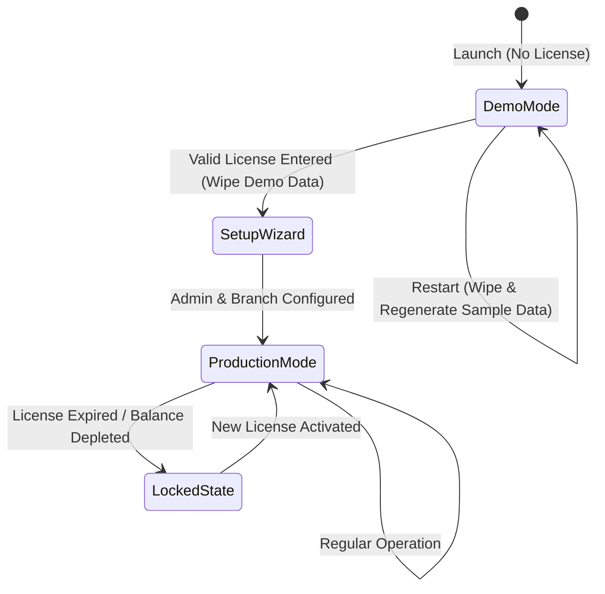

# VentaPOS NextGen — Requirements & Data Specifications

> **Scope**: VentaPOS NextGen Core Domain Specification  
> **Target Audience**: Back-Office Desk Management for Business Owner (المدير / صاحب المحل)  
> **Platform**: Django REST Framework + React 19 + PyWebView Standalone Windows Desktop  

---

## 1. System Overview & Domain Boundary

VentaPOS NextGen is a specialized commercial desktop management system tailored for Egyptian retail merchants in furniture, household goods, and domestic electronics (مفروشات، أدوات منزلية، أجهزة كهربائية).

### 1.1 Commercial Reality
- Sales personnel (مناديب) execute sales in the field and collect down payments, recording transactions in physical handwritten notebooks.
- The business manager enters these invoices into VentaPOS from his desk.
- The application manages multiple warehouse and showroom branches from a single unified desktop window. Each branch operates with completely isolated inventory.
- No barcodes or SKUs exist. Goods are identified by their commercial name.
- Selling prices are negotiated per transaction and entered manually on the receipt.

---

## 2. Active SQLite Data Models (16 Models)

All models are defined in `VentaPOS_NextGen/backend/api/models.py`. Standard integer primary keys (`AutoField`/`BigAutoField`) are used. All domain entities utilize soft-deletion via `is_deleted = models.BooleanField(default=False)` and an `ActiveManager`. Note: `MonthlyInventorySnapshot` was permanently retired in Pass 2 in favor of live composite-indexed queries, and `PendingExternalReceipt` was replaced by staging directly onto `Receipt(is_confirmed=False)`.

| # | Model | Arabic Name | Purpose & Key Fields |
|---|-------|-------------|----------------------|
| 1 | **`Branch`** | الفرع / المخزن | Branch location. Fields: `name`, `is_deleted`, `created_at`. Related: `inventory_items`, `salespersons`, `receipts`. |
| 2 | **`Salesperson`** | المندوب | Field salesperson. Fields: `name`, `branch` (FK), `device_token` (UUID), `is_device_active`, `is_deleted`. |
| 3 | **`InventoryItem`** | الصنف / البضاعة | Branch-scoped product. Fields: `name`, `branch` (FK), `initial_quantity`, `initial_purchase_price`, `initial_commission_amount`, `initial_month`, `initial_year`. Methods: `get_stock_at_date(m, y)`, `get_safe_available_qty()`, `get_commission_at_date(m, y)`, `get_price_at_date(m, y)`. |
| 4 | **`CommissionHistory`** | سجل عمولات المناديب | Historical sales commission changes. Fields: `item` (FK), `commission_amount`, `activation_month`, `activation_year`. |
| 5 | **`InventoryAdjustment`** | التسويات والجرد | Physical inventory adjustments. Fields: `item` (FK), `adjustment_type` (`DEFICIT` / `SURPLUS`), `quantity`, `reason`, `month`, `year`. |
| 6 | **`Supplier`** | المورد | Wholesale goods supplier. Fields: `name`, `is_deleted`. |
| 7 | **`PurchaseInvoice`** | فاتورة مشتريات / مرتجع | Inbound supplier shipment or return. Fields: `branch` (FK), `supplier` (FK), `invoice_number`, `invoice_type` (`PURCHASE` / `RETURN`), `invoice_month`, `invoice_year`. |
| 8 | **`PurchaseInvoiceItem`** | بنود فاتورة الشراء | Line item on purchase invoice. Fields: `invoice` (FK), `inventory_item` (FK), `quantity`, `purchase_price`. |
| 9 | **`Receipt`** | فاتورة المبيعات / المرتجع | Customer sale or return. Fields: `branch` (FK), `salesperson` (FK), `receipt_number`, `client_uuid`, `receipt_hash`, `customer_name`, `phone_number`, `address`, `area`, `total_amount`, `down_payment`, `installment_system`, `sale_year`, `sale_month`, `is_cash_sale`, `receipt_type` (`SALE` / `RETURN`), `parent_receipt` (FK self), `products_text`, `is_confirmed` (USB mobile sync staging; `False` indicates pending approval before stock deduction). |
| 10 | **`SaleItem`** | بنود الفاتورة | Line item on sale or return receipt. Fields: `receipt` (FK), `inventory_item` (FK), `quantity`, `unit_price`. |
| 11 | **`InstallmentPayment`** | قسط الفاتورة | Scheduled installment payment. Fields: `receipt` (FK), `payment_date` (`YYYY-MM-25`), `amount`. |
| 12 | **`Expense`** | المصروفات | Operating expenses. Fields: `branch` (FK), `category` (default `"مصروفات عامة"`), `description`, `amount`, `expense_month`, `expense_year`. |
| 13 | **`CompanySetting`** | إعدادات الشركة | Singleton configuration. Fields: `name`, `description`, `phone1`, `phone2`, `footer_text`, `collection_commission_rate` (Decimal, default `0.10`), `zoom_level`. |
| 14 | **`ClientLicense`** | الترخيص المحلي | Active cryptographic machine license. Fields: `product_id`, `start_date`, `expiry_date`, `invoices_balance`, `is_active`, `machine_id`, `company_code`, `license_code_hash`. |
| 15 | **`UsedLicense`** | التراخيص المستخدمة | SHA-256 hash preventing license code reuse. Fields: `code_hash` (unique). |
| 16 | **`LicenseHistory`** | أرشيف العمليات | Audit trail of license operations. Fields: `machine_id`, `product_name`, `operation_type`, `dates`, `added_balance`, `status`. |

---

## 3. Mathematical & Business Logic Specifications

### 3.1 Inventory Stock (Time-Machine Calculation)
Physical stock is not stored as a static mutable number. It is dynamically computed at any given monthly checkpoint $(m, y)$ using the time-machine formula:

$$\text{Stock}(m, y) = \max\Big(0,\ \text{InitialQty} + \text{Purchases} + \text{SalesReturns} - \text{Sales} - \text{PurchaseReturns} - \text{Deficit}\Big)$$

Where all cumulative terms are evaluated for business dates $\le (m, y)$:
- **$\text{InitialQty}$**: `initial_quantity` if $(m, y) \ge (\text{initial\_month}, \text{initial\_year})$, else $0$.
- **$\text{Purchases}$**: Sum of `PurchaseInvoiceItem.quantity` where `invoice.invoice_type = 'PURCHASE'`.
- **$\text{SalesReturns}$**: Sum of `SaleItem.quantity` where `receipt.receipt_type = 'RETURN'`.
- **$\text{Sales}$**: Sum of `SaleItem.quantity` where `receipt.receipt_type = 'SALE'`.
- **$\text{PurchaseReturns}$**: Sum of `PurchaseInvoiceItem.quantity` where `invoice.invoice_type = 'RETURN'`.
- **$\text{Deficit}$**: Sum of `InventoryAdjustment.quantity` where `adjustment_type = 'DEFICIT'`.

> [!IMPORTANT]
> A sales return (`receipt_type = 'RETURN'`) **restores** inventory stock to the branch. It must NEVER be added to sales deductions. Adjustments are strictly **Deficit (`DEFICIT` / `عجز`)**; Surplus (`SURPLUS`) is not supported.

### 3.2 Safe Available Quantity (`get_safe_available_qty`)
When back-dating an invoice or adjustment to $(m_{\text{target}}, y_{\text{target}})$, the system verifies that deducting stock in the past will not cause any intermediate month up to the current business month $(m_{\text{current}}, y_{\text{current}})$ to drop below zero:

$$\text{SafeAvailableQty} = \min_{t \in [(m_{\text{target}}, y_{\text{target}}),\ (m_{\text{current}}, y_{\text{current}})]} \text{Stock}(t)$$

### 3.3 Salesperson Monthly Compensation & Commission Workflow
Salespeople work strictly on a commission basis:
$$\text{Salary} = \sum_{\text{sold units}} \big(\text{مندبة}(p, m, y) \times \text{units}\big) + \Big(\text{CompanySetting.collection\_commission\_rate} \times \text{Monthly Collections}\Big)$$
- **$\text{مندبة}$ (Sales Commission)**: Fixed value per unit defined in `CommissionHistory` for product $p$ active at month $(m, y)$.
- **Commission Modifications (`تعديل المندبة`)**: Managed exclusively inside the Product Ledger (`ProductLedger.jsx` / `كارت الصنف`) where the manager can inspect the full chronological history and add/adjust commission checkpoints.
- **$\text{عمولة التحصيل}$ (Collection Commission)**: Evaluated dynamically using `CompanySetting.collection_commission_rate` (default $10\%$) multiplied by actual installment cash collected in that calendar month.

### 3.4 Installment Schedule Rules
- **Monthly Progression**: Given receipt total $T$, down payment $D$, and installment count $N$:
  $$\text{Monthly Installment} = \frac{T - D}{N}$$
- Installment 1 begins in $(m_{\text{sale}} + 1, y_{\text{sale}})$.
- **The 25th Display Rule**: Printed installment schedules format dates with day "25" (e.g. `2026-09-25`) to match commercial practice. Internal storage and filtering depend solely on `month` and `year`.

### 3.5 Buying Price Ranges by Date & Deficit Financial Loss
- **Date-Based Buying Price Ranges**: Buying prices (and COGS) are evaluated based on chronological purchase price ranges (`item.get_price_at_date(month, year)`), starting from `initial_purchase_price` at item creation and updated whenever a new `PURCHASE` invoice is entered. Moving average valuation is prohibited.
- **Deficit Financial Loss**: Each unit of physical inventory deficit incurs a financial loss equal to `deficit_qty * item.get_price_at_date(deficit_month, deficit_year)`. Total deficit loss is aggregated by summing the individual loss values of each adjustment and is deducted from Net Profit (`صافي المكسب`) across the Product Ledger, Dashboard Report, and Profit & Loss Report.

### 3.6 Old / Pre-License External Data Rules
- Old receipts imported or entered from external sources dated **before the active license start month (`sale_date < lic_start_month`)** have **no `SaleItem` records** (they store `products_text` only and manual `total_amount`).
- They are **Print & Edit Only** (no stock deduction, and exempt from deducting `ClientLicense.invoices_balance`).
- They are **excluded from all financial and inventory reports EXCEPT the Installments Report (`InstallmentsReport`) and Salesperson Collection Commission (`عمولة التحصيل`)** (and cash drawer collection inflows when their scheduled installments fall due).

---

## 4. Application Lifecycle & Licensing

1. **Demo Mode**: First run without license starts in Demo Mode. Demonstrates all reports and POS functionality using temporary mock data.
2. **License Activation**: Accepts an 80-bit encrypted cryptographic code bound to machine hardware hash. Once activated, demo data is wiped, creating an empty database for production setup.
3. **Password Recovery**: Utilizes a specialized Recovery Code license (`product_id in (15, 16)`) to reset the administrative password without cloud intervention.
4. **Print-Only Basic Plan (`product_id in (2, 3)`)**: Restricts the application strictly to Receipt CRUD & Printing (`POS.jsx` using free-text `products_text` + manual total amount, `SearchReceipts.jsx`, printing installment schedules, basic branch/salesperson setup, Backup/Restore, and Settings). Blocks all inventory, purchases, expenses, and analytical reports.

---

## 5. Active API Endpoint Catalog (`/api/v1/`)

### Authentication & Licensing
- `POST /api/v1/auth/local/`: Local password authentication (supports empty password for initial/unprotected systems).
- `POST /api/v1/auth/demo/`: Triggers demo mode session and returns demo auth token.
- `POST /api/v1/auth/recover/`: Recovers admin credentials using special recovery code.
- `GET /api/v1/auth/has-password/`: Checks if administrator password is established.
- `POST /api/v1/auth/change-password/`: Modifies administrator password.
- `GET /api/v1/license/status/`: License status, validity, expiry, `product_id` / `is_print_only`, and machine ID check.
- `POST /api/v1/license/activate/`: Activates 80-bit cryptographic license.
- `/api/v1/license-history/`: ReadOnlyModelViewSet for license audit history.

### Dimensions & Setup Data
- `/api/v1/branches/`: CRUD for branch locations (`ActiveManager`).
- `/api/v1/salespersons/`: CRUD for sales personnel (`branch_id` isolated).
- `/api/v1/suppliers/`: CRUD for wholesale suppliers.
- `/api/v1/company-settings/`: Singleton company profile & collection commission rate.

### Inventory & Stock
- `/api/v1/inventory-items/`: Product catalog with live computed stock.
  - `GET /inventory-items/{id}/stock/?month={m}&year={y}`: Computed stock at specific date.
  - `GET /inventory-items/{id}/ledger/`: Complete transaction time-machine timeline and deficit financial valuation.
- `/api/v1/commission-histories/`: Commission rate changes per product.
- `/api/v1/inventory-adjustments/`: Deficit stock adjustments (`DEFICIT` only) with safe quantity validation.

### Procurement & Sales
- `/api/v1/purchase-invoices/`: Supplier purchases and purchase returns (`PURCHASE` / `RETURN`).
  - `POST /purchase-invoices/desktop_print/`: Desktop printing / PDF preview of purchase and supplier return invoices (`pdf_purchase_content.html`).
- `/api/v1/purchase-invoice-items/`: Purchase line items.
- `/api/v1/receipts/`: Cash and installment sales receipts with HMAC integrity verification.
  - `GET /receipts/?branch_id={b}&month={m}&year={y}`: Paginated receipts with dataset aggregate totals.
  - `POST /receipts/bulk_delete/`: Atomic bulk deletion with inventory reconciliation.
  - `POST /receipts/desktop_print/`: Silent desktop printing / PDF preview of installment schedules.
  - `GET /receipts/printers/`: Lists installed Windows printers via PowerShell.
  - `POST /receipts/{id}/return_receipt/`: Creates return receipt restoring inventory.
- `/api/v1/sale-items/`: Sale line items.
- `/api/v1/installment-payments/`: Scheduled installment payments.
- `/api/v1/receipts-next-number/?branch_id={b}`: Branch-isolated sequential receipt number.
- `/api/v1/customer-suggestions/?term={t}&branch_id={b}`: Historical customer autocomplete.
- `/api/v1/product-suggestions/?term={t}&branch_id={b}`: Fast product autocomplete.
- `/api/v1/default-date/?branch_id={b}`: Returns highest chronological `(year, month)` active in branch.

### Analytics & Reports
- `GET /api/v1/reports/dashboard/summary/?branch_id={b}&month={m}&year={y}`: Dashboard summary cards and Cash Drawer breakdown.
- `GET /api/v1/reports/salesperson-performance/?branch_id={b}&month={m}&year={y}`: Salesperson commission, collections, and salaries.
- `GET /api/v1/reports/inventory-movement/?branch_id={b}&month={m}&year={y}`: 10-column stock ledger and valuation summary.
- `GET /api/v1/reports/profit-and-loss/?branch_id={b}&month={m}&year={y}`: Revenue, COGS, commissions, and net profit per item.
- `GET /api/v1/reports/purchases/?branch_id={b}&month={m}&year={y}`: Supplier purchases and purchase returns report.
- `GET /api/v1/reports/cash-drawer-details/?branch_id={b}&month={m}&year={y}`: Daily cash breakdown.
- `GET /api/v1/reports/installments/?branch_id={b}&month={m}&year={y}`: Monthly installment collections schedule and phone directory.
- `POST /api/v1/reports/desktop_print/`: Desktop printing / PDF export of any report table and KPI summary cards (`pdf_report_content.html`).
- `/api/v1/expenses/`: Operating branch expenditures (with `category` support).

### Tools & System
- `GET /api/v1/tools/backup/download/`: Downloads verified SQLite hot backup snapshot.
- `POST /api/v1/tools/backup/upload/`: Uploads, inspects, and stages/restores backup database (available from initial app launch / Demo / Login / Setup / Navbar).
- `POST /api/v1/frontend-logs/`: Ingests frontend error logs.
