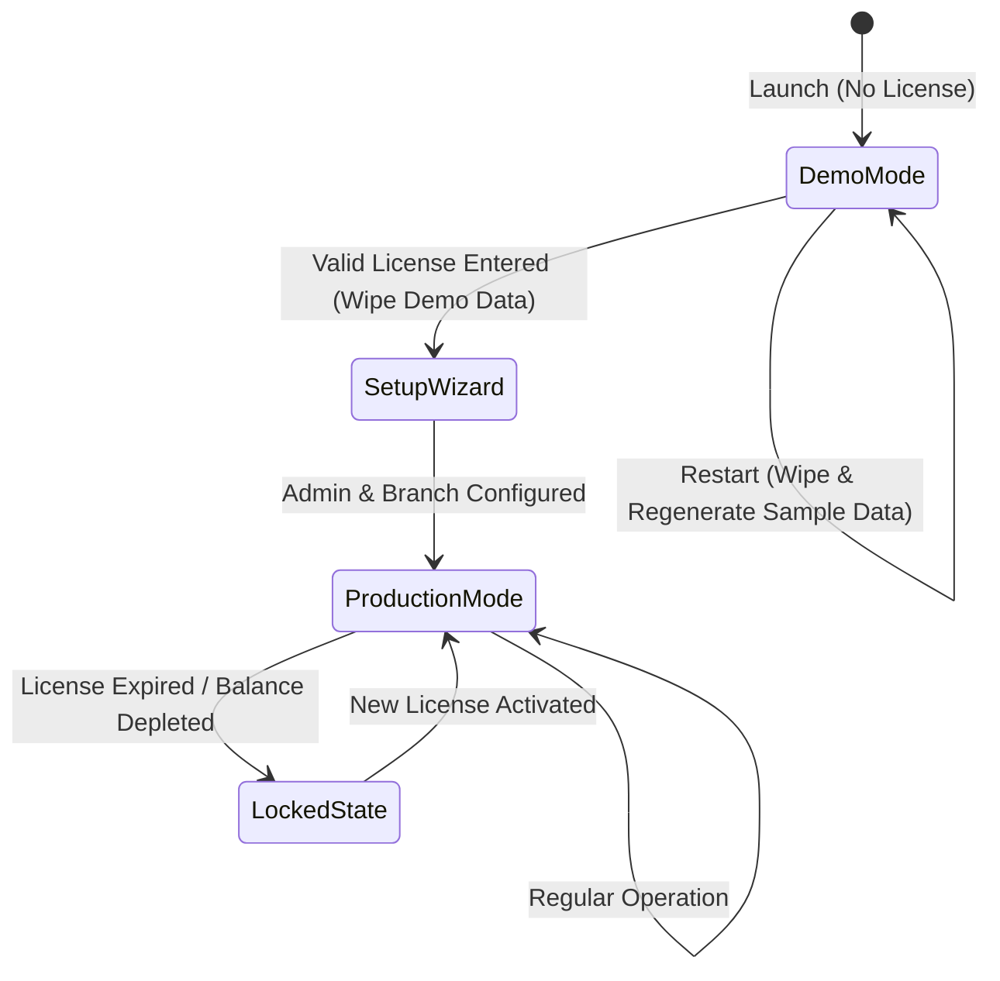

# VentaPOS NextGen — Requirements & Data Specifications

> **Scope**: VentaPOS NextGen Core Domain Specification  
> **Target Audience**: Back-Office Desk Management for Business Owner (المدير / صاحب المحل)  
> **Platform**: Django REST Framework + React 19 + PyWebView Standalone Windows Desktop  

---

## 1. System Overview & Domain Boundary

VentaPOS NextGen is a specialized commercial desktop management system tailored for Egyptian retail merchants in furniture, household goods, and domestic electronics (مفروشات، أدوات منزلية، أجهزة كهربائية).

### 1.1 Commercial Reality
- Sales personnel (مناديب) execute sales in the field and collect down payments, recording transactions in physical handwritten notebooks.
- The business manager enters these invoices into VentaPOS from his desk.
- The application manages multiple warehouse and showroom branches from a single unified desktop window. Each branch operates with completely isolated inventory.
- No barcodes or SKUs exist. Goods are identified by their commercial name.
- Selling prices are negotiated per transaction and entered manually on the receipt.

---

## 2. Active SQLite Data Models (17 Models)

All models are defined in `VentaPOS_NextGen/backend/api/models.py`. Standard integer primary keys (`AutoField`/`BigAutoField`) are used. All domain entities utilize soft-deletion via `is_deleted = models.BooleanField(default=False)` and an `ActiveManager`.

| # | Model | Arabic Name | Purpose & Key Fields |
|---|-------|-------------|----------------------|
| 1 | **`Branch`** | الفرع / المخزن | Branch location. Fields: `name`, `is_deleted`, `created_at`. Related: `inventory_items`, `salespersons`, `receipts`. |
| 2 | **`Salesperson`** | المندوب | Field salesperson. Fields: `name`, `branch` (FK), `device_token` (UUID), `is_device_active`, `is_deleted`. |
| 3 | **`InventoryItem`** | الصنف / البضاعة | Branch-scoped product. Fields: `name`, `branch` (FK), `initial_quantity`, `initial_purchase_price`, `initial_commission_amount`, `initial_month`, `initial_year`. Methods: `get_stock_at_date(m, y)`, `get_safe_available_qty()`, `get_commission_at_date(m, y)`, `get_price_at_date(m, y)`. |
| 4 | **`CommissionHistory`** | سجل عمولات المناديب | Historical sales commission changes. Fields: `item` (FK), `commission_amount`, `activation_month`, `activation_year`. |
| 5 | **`InventoryAdjustment`** | التسويات والجرد | Physical inventory adjustments. Fields: `item` (FK), `adjustment_type` (`DEFICIT` / `SURPLUS`), `quantity`, `reason`, `month`, `year`. |
| 6 | **`Supplier`** | المورد | Wholesale goods supplier. Fields: `name`, `is_deleted`. |
| 7 | **`PurchaseInvoice`** | فاتورة مشتريات / مرتجع | Inbound supplier shipment or return. Fields: `branch` (FK), `supplier` (FK), `invoice_number`, `invoice_type` (`PURCHASE` / `RETURN`), `invoice_month`, `invoice_year`. |
| 8 | **`PurchaseInvoiceItem`** | بنود فاتورة الشراء | Line item on purchase invoice. Fields: `invoice` (FK), `inventory_item` (FK), `quantity`, `purchase_price`. |
| 9 | **`Receipt`** | فاتورة المبيعات / المرتجع | Customer sale or return. Fields: `branch` (FK), `salesperson` (FK), `receipt_number`, `client_uuid`, `receipt_hash`, `customer_name`, `phone_number`, `address`, `area`, `total_amount`, `down_payment`, `installment_system`, `sale_year`, `sale_month`, `is_cash_sale`, `receipt_type` (`SALE` / `RETURN`), `parent_receipt` (FK self), `products_text`, `is_confirmed`. |
| 10 | **`SaleItem`** | بنود الفاتورة | Line item on sale or return receipt. Fields: `receipt` (FK), `inventory_item` (FK), `quantity`, `unit_price`. |
| 11 | **`InstallmentPayment`** | قسط الفاتورة | Scheduled installment installment. Fields: `receipt` (FK), `payment_date` (`YYYY-MM-25`), `amount`. |
| 12 | **`Expense`** | المصروفات | Operating expenses. Fields: `branch` (FK), `description`, `amount`, `expense_month`, `expense_year`. |
| 13 | **`CompanySetting`** | إعدادات الشركة | Singleton configuration. Fields: `name`, `description`, `phone1`, `phone2`, `footer_text`, `collection_commission_rate` (Decimal, default `0.10`), `zoom_level`. |
| 14 | **`ClientLicense`** | الترخيص المحلي | Active cryptographic machine license. Fields: `product_id`, `start_date`, `expiry_date`, `invoices_balance`, `is_active`, `machine_id`, `company_code`, `license_code_hash`. |
| 15 | **`UsedLicense`** | التراخيص المستخدمة | SHA-256 hash preventing license code reuse. Fields: `code_hash` (unique). |
| 16 | **`LicenseHistory`** | أرشيف العمليات | Audit trail of license operations. Fields: `machine_id`, `product_name`, `operation_type`, `dates`, `added_balance`, `status`. |
| 17 | **`PendingExternalReceipt`** | فواتير المزامنة المؤقتة | Staging table for offline batch USB receipts. Fields: `branch` (FK), `batch_id`, `source`, `payload` (JSON), `is_processed`. |

---

## 3. Mathematical & Business Logic Specifications

### 3.1 Inventory Stock (Time-Machine Calculation)
Physical stock is not stored as a static mutable number. It is dynamically computed at any given monthly checkpoint $(m, y)$ using the time-machine formula:

$$\text{Stock}(m, y) = \max\Big(0,\ \text{InitialQty} + \text{Purchases} + \text{Surplus} + \text{SalesReturns} - \text{Sales} - \text{PurchaseReturns} - \text{Deficit}\Big)$$

Where all cumulative terms are evaluated for business dates $\le (m, y)$:
- **$\text{InitialQty}$**: `initial_quantity` if $(m, y) \ge (\text{initial\_month}, \text{initial\_year})$, else $0$.
- **$\text{Purchases}$**: Sum of `PurchaseInvoiceItem.quantity` where `invoice.invoice_type = 'PURCHASE'`.
- **$\text{Surplus}$**: Sum of `InventoryAdjustment.quantity` where `adjustment_type = 'SURPLUS'`.
- **$\text{SalesReturns}$**: Sum of `SaleItem.quantity` where `receipt.receipt_type = 'RETURN'`.
- **$\text{Sales}$**: Sum of `SaleItem.quantity` where `receipt.receipt_type = 'SALE'`.
- **$\text{PurchaseReturns}$**: Sum of `PurchaseInvoiceItem.quantity` where `invoice.invoice_type = 'RETURN'`.
- **$\text{Deficit}$**: Sum of `InventoryAdjustment.quantity` where `adjustment_type = 'DEFICIT'`.

> [!IMPORTANT]
> A sales return (`receipt_type = 'RETURN'`) **restores** inventory stock to the branch. It must NEVER be added to sales deductions.

### 3.2 Safe Available Quantity (`get_safe_available_qty`)
When back-dating an invoice or adjustment to $(m_{\text{target}}, y_{\text{target}})$, the system verifies that deducting stock in the past will not cause any intermediate month up to the current business month $(m_{\text{current}}, y_{\text{current}})$ to drop below zero:

$$\text{SafeAvailableQty} = \min_{t \in [(m_{\text{target}}, y_{\text{target}}),\ (m_{\text{current}}, y_{\text{current}})]} \text{Stock}(t)$$

### 3.3 Salesperson Monthly Compensation
Salespeople work strictly on a commission basis:
$$\text{Salary} = \sum_{\text{sold units}} \big(\text{مندبة}(p, m, y) \times \text{units}\big) + \Big(\text{CompanySetting.collection\_commission\_rate} \times \text{Monthly Collections}\Big)$$
- **$\text{مندبة}$ (Sales Commission)**: Fixed value per unit defined in `CommissionHistory` for product $p$ active at month $(m, y)$.
- **$\text{عمولة التحصيل}$ (Collection Commission)**: Evaluated dynamically using `CompanySetting.collection_commission_rate` (default $10\%$) multiplied by actual installment cash collected in that calendar month.

### 3.4 Installment Schedule Rules
- **Monthly Progression**: Given receipt total $T$, down payment $D$, and installment count $N$:
  $$\text{Monthly Installment} = \frac{T - D}{N}$$
- Installment 1 begins in $(m_{\text{sale}} + 1, y_{\text{sale}})$.
- **The 25th Display Rule**: Printed installment schedules format dates with day "25" (e.g. `2026-09-25`) to match commercial practice. Internal storage and filtering depend solely on `month` and `year`.

---

## 4. Application Lifecycle & Licensing

1. **Demo Mode**: First run without license starts in Demo Mode. Demonstrates all 8 reports and POS functionality using temporary mock data.
2. **License Activation**: Accepts an 80-bit encrypted cryptographic code bound to machine hardware hash. Once activated, demo data is wiped, creating an empty database for production setup.
3. **Password Recovery**: Utilizes a specialized Recovery Code license (`product_id = 15`) to reset the administrative password without cloud intervention.

---

## 5. Active API Endpoint Catalog (`/api/v1/`)

### Authentication & Setup
- `POST /api/v1/auth/login/`: Admin token authentication.
- `GET /api/v1/auth/has-password/`: Checks if initial admin password has been established.
- `POST /api/v1/auth/recover-password/`: Recovers admin credentials using special recovery code.
- `POST /api/v1/auth/demo/`: Triggers demo mode initialization.

### Dimensions & Setup Data
- `/api/v1/branches/`: CRUD for branch locations (`ActiveManager`).
- `/api/v1/salespersons/`: CRUD for sales personnel.
- `/api/v1/suppliers/`: CRUD for wholesale suppliers.
- `/api/v1/company-settings/`: Singleton company profile & collection commission rate.

### Inventory & Stock
- `/api/v1/inventory-items/`: Product catalog with live computed stock.
  - `GET /inventory-items/{id}/stock/?month={m}&year={y}`: Computed stock at specific date.
  - `GET /inventory-items/{id}/ledger/`: Complete transaction time-machine timeline.
  - `GET /inventory-items/pos_search/?term={term}`: Fast autocomplete search.
- `/api/v1/inventory-adjustments/`: Deficit/surplus stock adjustments with safe quantity validation.

### Procurement & Sales
- `/api/v1/purchase-invoices/`: Supplier purchases and purchase returns.
- `/api/v1/receipts/`: Cash and installment sales receipts with HMAC integrity verification.
  - `GET /receipts/?branch_id={b}&month={m}&year={y}`: Paginated receipts with dataset aggregate totals.
  - `GET /receipts/customer_suggestions/?term={t}&field={f}`: Historical customer autocomplete.
  - `POST /receipts/{id}/print/`: Generates PDF schedule and triggers SumatraPDF silent print.

### Analytics & Reports
- `GET /api/v1/reports/dashboard/?branch_id={b}&month={m}&year={y}`: P&L breakdown and Cash Drawer breakdown.
- `GET /api/v1/reports/salesperson-performance/`: Grouped sales performance, collections, and salaries.
- `GET /api/v1/reports/inventory-movement/`: 10-column stock ledger and valuation summary.
- `GET /api/v1/reports/profit-and-loss/`: Revenue, COGS, commissions, and net profit per item.
- `GET /api/v1/reports/averages/`: Per-unit averages across products (0 KPI cards).
- `GET /api/v1/reports/installments/`: Monthly installment collections schedule and phone directory.
- `GET /api/v1/expenses/`: Operating branch expenditures.
